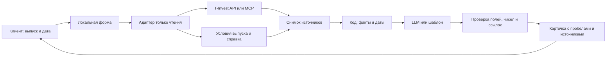

# Система: данные, модели, схема и стоимость

[Итерация З](README.md)

- [Идеи](ideas.md)
- [Концепция](concept.md)
- [Система](system.md)
- [Проверка и риски](evaluation.md)
- [Черновик заявки](application.md)

Предполагаемый контур для [одной проверки облигации](concept.md#passport). Разработка, вызовы API/MCP и сравнение моделей не выполнялись. Полную спецификацию после выбора продукта ведёт [№3](https://github.com/vafaevelshodbek-png/invest-premarket/issues/3).

## Входы для №3

| Вход | Источник и формат | Обновление | Неизвестное |
|---|---|---|---|
| Выпуск и дата проверки | Форма клиента, идентификатор и дата | На запрос | Нужен однозначный идентификатор |
| Условия облигации | Каталог T-Invest API, структурированные поля | При проверке, с датой снимка | Полнота по выбранному выпуску не проверена |
| Оферта, амортизация, погашение | `GetBondEvents`, структурированные события | При проверке | Наличие метода в MCP и покрытие выпуска не проверены |
| Условия события | Официальное раскрытие эмитента, текст или PDF | При публикации или изменении | Доступ к полному комплекту и право обработки |
| Срок и порядок обращения к брокеру | Применимый регламент и справка брокера | При изменении | Нельзя выводить клиентский срок из одной даты события |

Счёт, полный портфель, история операций, посты и торговые права в этой версии не нужны. Наличие контрактов не означает работающего доступа. Для MCP нужен просмотр `tools/list`, затем чтение конкретного выпуска. Если инструмент отсутствует, отдельно оценивается прямой API или ручной источник.

## AI-подходы и модели (№23)

Предварительно для формы: **LLM**. Код получает данные и проверяет даты, LLM объясняет конкретные фрагменты условий. Нужность динамического агента, RAG, векторного индекса и большого контекста не установлена. Они не являются обязательными компонентами первой проверки.

Начальное сравнение: шаблон с теми же фактами против LLM с источниками. Выбор модели и её тарифа относится к [№23](https://github.com/vafaevelshodbek-png/invest-premarket/issues/23) после проверки русского текста, чисел, ссылок, отказов и условий обработки данных.

**Объяснение для поля 6, до 400 знаков:**

> LLM объясняет условия события по проверенным фрагментам источников. Идентификацию выпуска, даты и расчёты выполняет код. Сравним объяснение с обычным чек-листом и шаблоном на тех же данных. Если LLM не улучшит правильность разбора, оставим шаблон. Динамический агент и отдельный RAG пока не обоснованы.

## Схема MVP (№24)

Токен остаётся в локальном адаптере и не передаётся модели. Счёт и операции не запрашиваются. Внешней LLM можно передавать только необходимый контекст, допустимость которого проверена по условиям источников и провайдера. Публичность документа не равна разрешению на любую ретрансляцию. Если передача недопустима, нужен локальный вариант или шаблон. В журнале сохраняются идентификатор проверки, источники и ошибки без токенов и данных счёта.

Исполнение сделок и Telegram не входят в эту версию. Кнопка подтверждения торговой операции не предполагается свойством MCP. Встраивание в приложение брокера остаётся отдельным вопросом. Смысловая корректность текста проверяется экспериментом, программный валидатор её не гарантирует.

## Стоимость и осуществимость (№35)

Модель расходов для выбранного решения уточняется в [№35](https://github.com/vafaevelshodbek-png/invest-premarket/issues/35). Суммируются входные и выходные токены всех вызовов, включая повторный контекст и повторные прогоны. Приведённые ниже значения сохранены как допущение этой итерации, а не подтверждённая стоимость нового решения.

Для ориентира, при допущении 20 тыс. входных и 4 тыс. выходных токенов за законченный сценарий:

| Модель, синхронный режим | Только модель, ₽ | С резервом 50%, ₽ |
|---|---|---|
| Alice AI LLM Flash, 0,10 / 0,20 ₽ за 1000 входных / выходных токенов | 2,80 | 4,20 |
| YandexGPT Pro 5.1, 0,80 / 0,80 ₽ за 1000 входных / выходных токенов | 19,20 | 28,80 |

[Тарифы Yandex AI Studio](https://aistudio.yandex.ru/ru/docs/ai-studio/pricing), рубли с НДС, проверены 14 ноября 2026 года. Нагрузка является допущением и не измерена на этой карточке. Инфраструктура, подготовка документов, поиск, OCR и труд считаются отдельно. Бесплатность API в пределах лимитов не подтверждает доступ и право передачи данных.

До оценки срока нужно получить полный комплект одного выпуска, проверить доступ, подготовить базовый способ и набор примеров. Десять дней SYSTEM BUILD являются условным горизонтом будущего этапа, а не подтверждённой трудоёмкостью. Занятость команды и задержка не измерены. Причины пересмотра: недоступны условия события, нельзя разрешённо обработать вход, шаблон не хуже LLM или задержка и полная стоимость неприемлемы пользователю.
