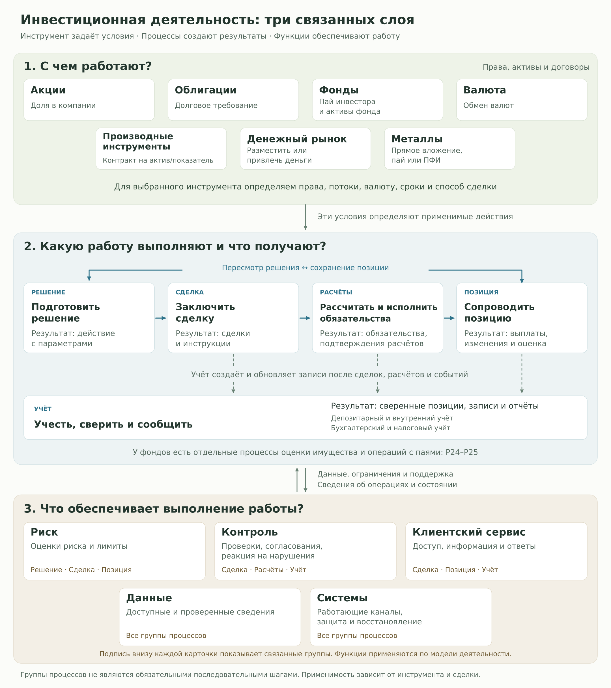

# Карта инвестиционной деятельности: порядок работы

В комплекте есть обзор семи областей, 25 основных процессов P01–P25, 14 обеспечивающих функций S01–S14 и источники. Следующий результат работы команды: **для каждого процесса понять, кто, когда и как выполняет работу, что получает и кому передаёт результат.** Из этих разборов собирается таблица ролей и задач для [№31](https://github.com/vafaevelshodbek-png/invest-premarket/issues/31).

**Начать сейчас:** открыть карточки первого блока в разделе 3, разобрать их по восьми вопросам из раздела 2 и записать результаты. Затем перейти ко второму блоку. [Очередь всех 39 разборов с конкретными вопросами](process-study.md#queue).

[Общий контекст](#overview) · [Схема разбора](#scheme) · [Порядок изучения](#order) · [Результат прохода](#result) · [Дальнейшие шаги](#next) · [Материалы](#navigation)

## 1. Сначала понять устройство карты

Верхний слой показывает, **с чем работают**: акции, облигации, фонды, валюта, ПФИ, денежный рынок и металлы. Средний показывает, **какую работу выполняют и что получают**. Нижний показывает, **какие функции дают данные, ограничения, проверки и поддержку**.

Посмотрите [обзорную карту](assets/overview.svg) и прочитайте [сквозной пример покупки облигации для фонда](overview-guide.md#example). После этого проследите четыре разных результата: решение о покупке, заключённую сделку, исполненные обязательства и записи учёта. Объясните, какие сведения передаются между ними и почему учёт начинается до завершения расчётов.

Показать обзорную карту

**Результат этого шага:** участник может объяснить один пример целиком и назвать вопросы, которые пока не понял. Эти вопросы проверяем при разборе соответствующих процессов.

## 2. Каждый процесс разобрать по одной схеме

Откройте его карточку в [справочнике](processes.md). Вход, выход, применимость и ссылки уже собраны. На их основе восстановите работу человека и проверьте недостающее по источникам.

| Вопрос | Что записать в разбор |
|---|---|
| **1. Когда и зачем?** | Событие, которое запускает работу, и задача, которую нужно завершить |
| **2. Кто делает?** | Роль человека, его сторона и ответственность. Например, специалист расчётов у брокера |
| **3. Что получает на вход?** | Данные, документы, инструкции. От кого они приходят, из какого процесса |
| **4. Что делает?** | Последовательность из 3–5 действий и используемые документы или системы, если они известны |
| **5. Что должно получиться?** | Конкретный документ, запись, расчёт, решение или статус. По чему понятно, что работа завершена |
| **6. Кому передаёт?** | Получатель результата и следующий процесс по ID. Если результат предназначен клиенту, назвать клиента |
| **7. Что бывает при отклонении?** | Например, неполные данные, отказ, несовпадение записей. Кто и как продолжает работу |
| **8. На чём основано описание?** | Источники, применимые инструмент и договор. Отдельно: подтверждённое, предполагаемое и вопрос для проверки |

Для функций S используем ту же схему. Их результатом может быть лимит, акцепт, ответ клиенту или восстановленный процесс. Указываем, в какие процессы P этот результат поступает.

На первом проходе берём **один применимый пример для каждого P/S**. Вариант по другому инструменту добавляем, если меняются исполнитель, документы, действия или результат. Вопрос, на который нет основания ответить, записываем вместе со способом проверки.

[Посмотреть пример разбора P08 по всем восьми вопросам](process-study.md#example).

## 3. Пройти всю карту в восьми блоках

Это порядок изучения. В реальной работе часть процессов выполняется параллельно и повторяется.

| Блок | Процессы и функции | Что выяснить |
|---|---|---|
| [1. Данные, анализ и решение](process-study.md#preparation) | [P01](processes.md#p01) · [P02](processes.md#p02) · [P03](processes.md#p03) · [P04](processes.md#p04) · [S01](processes.md#s01) · [S11](processes.md#s11) · [S12](processes.md#s12) | Как из целей и сведений получается решение, какие данные и ограничения обеспечивают эту работу |
| [2. Доступ, поручение и сделка](process-study.md#trade) | [S09](processes.md#s09) · [P05](processes.md#p05) · [P06](processes.md#p06) · [P07](processes.md#p07) · [P08](processes.md#p08) | Чем различаются допуск, приём поручения, размещение, сделка и согласование инструкций |
| [3. Обязательства, покрытие и расчёты](process-study.md#settlement) | [P09](processes.md#p09) · [S02](processes.md#s02) · [P15](processes.md#p15) · [P10](processes.md#p10) · [P16](processes.md#p16) | Кто определяет обязательства, оценивает покрытие, организует средства и исполняет движения |
| [4. Права, внутренние записи и сверка](process-study.md#records) | [P11](processes.md#p11) · [P12](processes.md#p12) · [P13](processes.md#p13) | Как связаны разные записи об одной операции и как устраняются несовпадения |
| [5. Сопровождение позиции и результат](process-study.md#position) | [P14](processes.md#p14) · [P17](processes.md#p17) · [P18](processes.md#p18) · [P23](processes.md#p23) | Что запускают состояние портфеля, события актива и решение владельца |
| [6. Бухгалтерия, налоги и отчёты](process-study.md#reports) | [P19](processes.md#p19) · [P20](processes.md#p20) · [P21](processes.md#p21) · [P22](processes.md#p22) | Какие сведения нужны каждому получателю и чем отличаются четыре результата |
| [7. Работа с имуществом фонда и паями](process-study.md#fund) | [P24](processes.md#p24) · [P25](processes.md#p25) · [S07](processes.md#s07) | Как различаются оценка имущества, операция с паем и контроль распоряжения |
| [8. Контроль, сервис и устойчивость](process-study.md#support) | [S03](processes.md#s03) · [S04](processes.md#s04) · [S05](processes.md#s05) · [S06](processes.md#s06) · [S08](processes.md#s08) · [S10](processes.md#s10) · [S13](processes.md#s13) · [S14](processes.md#s14) | Какие события требуют проверки или реакции и какой результат возвращается в работу |

В [очереди разборов](process-study.md#queue) для каждого из 39 пунктов задан отдельный вопрос. Разбирать блоки можно разным участникам. У каждого блока должны быть ведущий и проверяющий. На общей сверке проверяющий прослеживает входы, выходы и передачи между соседними блоками.

Для этой сверки используйте [карту метро](assets/metro-map.svg) и [таблицу её связей](metro.md#connections): передаваемый результат должен быть указан среди входов получателя. Если связи не хватает или её применимость неясна, зафиксируйте конкретный вопрос к источнику или исполнителю.

## 4. Собрать результат для следующего исследования

Разборы сводим в существующем разделе [«Исследования»](https://github.com/vafaevelshodbek-png/invest-premarket/wiki/Research), промежуточные выводы связываем с [№31](https://github.com/vafaevelshodbek-png/invest-premarket/issues/31).

Итоговая таблица: **область и условия → ID процесса → роль → ситуация → задача → текущие действия → вход → результат → получатель**. Если в одном процессе разные люди выполняют разные задачи, для них нужны отдельные строки. Рядом указываем основания, частоту и последствия ошибки либо статус «неизвестно». Отдельно отмечаем, кто пользуется результатом и кто мог бы покупать решение.

Первый проход завершён, когда все 39 пунктов просмотрены, разборы записаны, пробелы названы и проверяющий сверил передачи результатов. Для углубления отмечаем ситуации с конкретным исполнителем и результатом, указывая основание интереса и то, что ещё предстоит проверить.

## 5. Что делать после прохода

| На входе | Следующее действие | Какой результат передаём дальше |
|---|---|---|
| Разобранные роли и ситуации | В [№32](https://github.com/vafaevelshodbek-png/invest-premarket/issues/32) восстановить текущие способы, проверить аналоги и затруднения. В [№33](https://github.com/vafaevelshodbek-png/invest-premarket/issues/33) сопоставить форматы с этой работой | Ситуации с описанным текущим способом, основаниями предполагаемого улучшения и подходящим форматом |
| Эти ситуации | В [№18](https://github.com/vafaevelshodbek-png/invest-premarket/issues/18) сформировать сравнимых кандидатов | Для каждого: пользователь, задача, результат, формат, ожидаемое изменение и открытые вопросы |
| Кандидаты | Проверить данные в [№19](https://github.com/vafaevelshodbek-png/invest-premarket/issues/19) и роль AI в [№22](https://github.com/vafaevelshodbek-png/invest-premarket/issues/22). Использовать готовый разбор API/MCP из [№30](https://github.com/vafaevelshodbek-png/invest-premarket/issues/30) | Основания осуществимости, обычные альтернативы AI и критичные условия |
| Проверенные основания по кандидатам | Командой выбрать одну идею в [№2](https://github.com/vafaevelshodbek-png/invest-premarket/issues/2) | Решение с причинами выбора и оставшимися допущениями |
| Одна выбранная идея | Описать сценарий, данные, реализацию, план эксперимента и риски, затем собрать заявку | Согласованный комплект ответов. В плане эксперимента есть базовый способ, одна основная метрика и обоснованный порог |

## 6. Где лежат материалы

| Материал | Для какой работы нужен |
|---|---|
| [Справочник процессов](processes.md) | Исходные карточки P/S с входами, выходами и источниками |
| [Очередь изучения](process-study.md) | Конкретный вопрос к каждому процессу, отметки прохождения и пример разбора |
| [Обзор с пояснениями](overview-guide.md) | Саммари, подробное объяснение слоёв, пример, навигация по рынкам и словарь |
| [Карта метро и связи](metro.md) | Проверка передачи результатов между процессами |
| [Полный отчёт](report.md) | Метод, особенности рынков, границы охвата и ограничения |
| [Указатель источников](sources.md) | Поиск документа по коду R и обратные ссылки к карточкам |

Основа материалов: исследование от 8 ноября 2026 года. Восстановленная по документам последовательность действий и предполагаемая роль должны оставаться отличимыми от работы, подтверждённой конкретным исполнителем.
