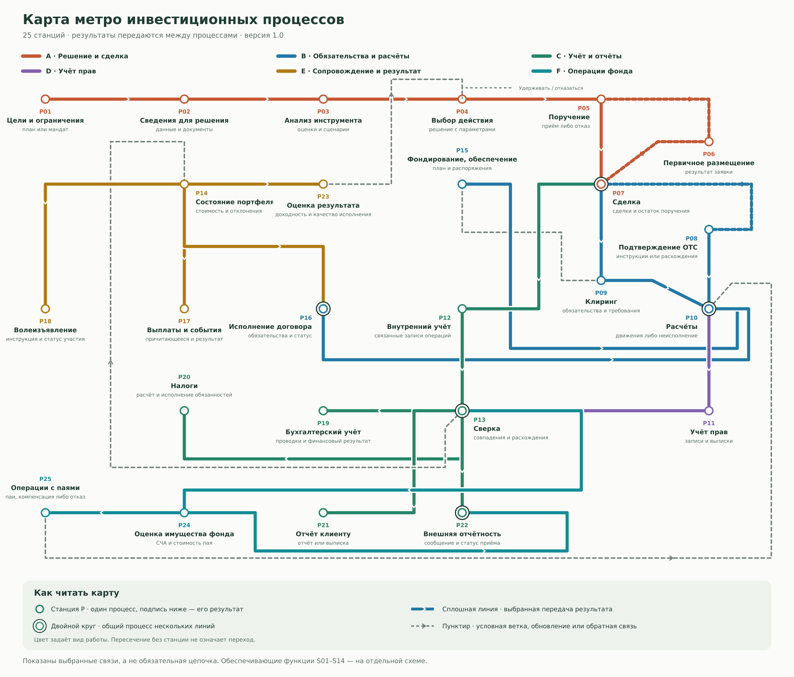
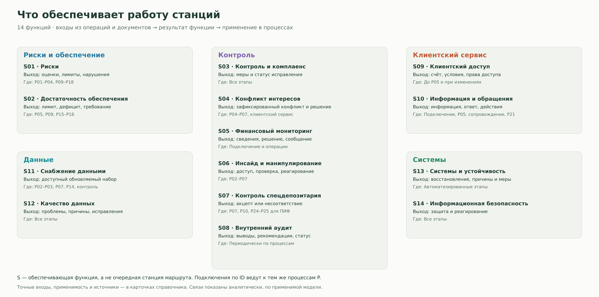

# Карта метро: станции, связи и применимость

[К входной странице](README.md#metro) · [К справочнику процессов](processes.md)

Карта разворачивает средний и нижний слои обзорной схемы. Верхний слой задаёт применимость: инструмент, договор, права, потоки и сроки определяют нужные процессы. Цвет линии обозначает вид работы, а не класс актива или конкретное подразделение.

Основа: [исследование от 8 ноября 2026 года](report.md). Передачи результатов ниже являются аналитическим синтезом входов и выходов карточек. Это выбранные связи, а не полный регламент или доказательство обязательности каждого перехода.

[SVG для увеличения и редактирования](assets/metro-map.svg) · [Данные станций и связей](assets/metro-data.json)

## Легенда

| Знак | Значение |
|---|---|
| Круг P | Один основной процесс. ID совпадает с карточкой справочника |
| Двойной круг | Общий процесс нескольких цветных линий. Процесс не дублируется |
| Цветная сплошная линия | Выбранная передача результата по стрелке. Применимость уточняется в таблице связей |
| Цветной пунктир | Условная ветка: первичное размещение или отдельное OTC-подтверждение |
| Серый пунктир | Данные, обновление состояния или обратная связь |
| Пересечение без станции | Связи в точке пересечения нет |
| Блок S на схеме поддержки | Обеспечивающая функция с указанными точками подключения |

OTC означает внебиржевую сделку. Состав процесса зависит от договора и инфраструктурной модели. Наличие линии на карте не означает, что все её станции обязательны для каждой операции.

### Линии

| Линия | Вид работы | Вопрос |
|---|---|
| A · Терракотовая | Решение и сделка | Как намерение превращается в принятое поручение и сделку? |
| B · Синяя | Обязательства и расчёты | Что нужно исполнить и какими движениями это выполняется? |
| C · Зелёная | Внутренний учёт, сверка и отчёты | Как связать записи, подтвердить их и подготовить нужные сведения? |
| D · Фиолетовая | Учёт прав | Как движение бумаг отражается в записях о правах? |
| E · Охристая | Сопровождение и результат | Что происходит с позицией и что становится основанием пересмотра? |
| F · Бирюзовая | Операции фонда | Как данные об имуществе связаны со стоимостью и операциями с паями? |

## Указатель станций

Станция помещена в таблице один раз по основному виду работы. Общие узлы остаются теми же процессами при переходе на другую линию.

### A. Решение и сделка

| Станция | Работа | Результат |
|---|---|---|
| [P01](processes.md#p01) | Цели и ограничения | план или мандат |
| [P02](processes.md#p02) | Сведения для решения | данные и документы |
| [P03](processes.md#p03) | Анализ инструмента | оценки и сценарии |
| [P04](processes.md#p04) | Выбор действия | решение с параметрами |
| [P05](processes.md#p05) | Поручение | приём либо отказ |
| [P06](processes.md#p06) | Первичное размещение | результат заявки |
| [P07](processes.md#p07) | Сделка | сделки и остаток поручения |

### B. Обязательства и расчёты

| Станция | Работа | Результат |
|---|---|---|
| [P08](processes.md#p08) | Подтверждение OTC | инструкции или расхождения |
| [P09](processes.md#p09) | Клиринг | обязательства и требования |
| [P10](processes.md#p10) | Расчёты | движения либо неисполнение |
| [P15](processes.md#p15) | Фондирование, обеспечение | план и распоряжения |
| [P16](processes.md#p16) | Исполнение договора | обязательства и статус |

### C. Учёт и отчёты

| Станция | Работа | Результат |
|---|---|---|
| [P12](processes.md#p12) | Внутренний учёт | связанные записи операций |
| [P13](processes.md#p13) | Сверка | совпадения и расхождения |
| [P19](processes.md#p19) | Бухгалтерский учёт | проводки и финансовый результат |
| [P20](processes.md#p20) | Налоги | расчёт и исполнение обязанностей |
| [P21](processes.md#p21) | Отчёт клиенту | отчёт или выписка |
| [P22](processes.md#p22) | Внешняя отчётность | сообщение и статус приёма |

### D. Учёт прав

| Станция | Работа | Результат |
|---|---|---|
| [P11](processes.md#p11) | Учёт прав | записи и выписки |

### E. Сопровождение и результат

| Станция | Работа | Результат |
|---|---|---|
| [P14](processes.md#p14) | Состояние портфеля | стоимость и отклонения |
| [P17](processes.md#p17) | Выплаты и события | причитающееся и результат |
| [P18](processes.md#p18) | Волеизъявление | инструкция и статус участия |
| [P23](processes.md#p23) | Оценка результата | доходность и качество исполнения |

### F. Операции фонда

| Станция | Работа | Результат |
|---|---|---|
| [P24](processes.md#p24) | Оценка имущества фонда | СЧА и стоимость пая |
| [P25](processes.md#p25) | Операции с паями | паи, компенсация либо отказ |

## Как работают пересадки

| Узел | Что связывает | Что важно различать |
|---|---|---|
| [P07](processes.md#p07) | Решение, расчёты и внутренний учёт | Сделка создаёт документы для учёта до завершения расчётов |
| [P10](processes.md#p10) | Денежные и поставочные движения, учёт прав | Расчёт исполняет обязательство. Для бумаг его результат отражается в P11. У ПФИ не всегда возникает поставка бумаги |
| [P13](processes.md#p13) | Внутренние записи, внешние выписки, оценка и отчётность | Сверка сопоставляет записи, а не создаёт вместо них исходные документы. Расхождения требуют разбора и обоснованных исправлений |
| [P16](processes.md#p16) | Сопровождение позиции и новые обязательства | Исполнение договора, закрытие и перенос различаются. Фактические движения проходят через P10 |
| [P22](processes.md#p22) | Учётные сведения и данные оценки фонда | Получатель и состав сообщения зависят от требований. Это не один универсальный отчёт |

## Учёт идёт параллельно расчётам

После P07 документы сделки поступают в P12. P10 затем даёт подтверждения или статусы, обновляющие записи. P11 даёт сведения о правах на бумаги. В P13 внутренние записи сравниваются с внешними выписками и отчётами, включая банковские и клиринговые. На рисунке выделены два входа в сверку, а их полный состав определяется карточкой P13.

Проводки P19, налоговые обязанности P20, клиентский отчёт P21 и внешние сообщения P22 имеют разные результаты. Сверенные данные используются в них по применимости. Они не образуют обязательную последовательность друг за другом.

## Три маршрута для знакомства

1. **Сделка с бумагами и клирингом:** P04 → P05 → P07 → P09 → P10 → P11 → P13. Параллельно P07 → P12 → P13. Для отдельного OTC-подтверждения используется P08, при первичном размещении возникает P06. Отказ и частичное исполнение описаны в карточках.
2. **Жизнь позиции:** P13 → P14, затем обработка события в P17 или P18 либо срока договора в P16. P14 и P23 отвечают на разные вопросы: текущее состояние и полученный результат. Выводы P23 могут стать входом нового решения P04. Само P14 также может выявить основание пересмотра.
3. **Имущество фонда и пай:** P13 → P24. Расчётная стоимость используется в применимой операции P25 при наличии заявки и требований правил фонда. Оплата или компенсация задействует P10, а результат возвращается в учёт. Вторичная сделка с уже существующим паем относится к P07.

Решение P04 может состоять в удержании позиции или отказе от операции. Сопровождение существующей позиции не требует новой сделки. Фондирование и обеспечение P15 могут потребоваться до сделки и в течение жизни позиции, поэтому вход из P09 является лишь одной из показанных связей. Поступление выплат и исполнение договора могут повторно задействовать расчёты и учёт.

## Обеспечивающие функции

[SVG схемы поддержки](assets/metro-support.svg)

Каждая функция получает сведения об операциях, состоянии или документах и возвращает свой результат. Перечень ниже указывает точки применения, а не обязательный порядок проверок. Более точные входы, выходы и источники находятся в карточках.

| Функция | Результат | Точки подключения |
|---|---|---|
| [S01](processes.md#s01) · Риски | оценки, лимиты, нарушения | P01–P04, P09–P18 |
| [S02](processes.md#s02) · Достаточность обеспечения | лимит, дефицит, требование | P05, P09, P15–P16 |
| [S03](processes.md#s03) · Контроль и комплаенс | меры и статус исправления | Все этапы |
| [S04](processes.md#s04) · Конфликт интересов | зафиксированный конфликт и решение | P04–P07, клиентский сервис |
| [S05](processes.md#s05) · Финансовый мониторинг | сведения, решение, сообщение | Подключение и операции |
| [S06](processes.md#s06) · Инсайд и манипулирование | доступ, проверка, реагирование | P02–P07 |
| [S07](processes.md#s07) · Контроль спецдепозитария | акцепт или несоответствие | P07, P10, P24–P25 для ПИФ |
| [S08](processes.md#s08) · Внутренний аудит | выводы, рекомендации, статус | Периодически по процессам |
| [S09](processes.md#s09) · Клиентский доступ | счёт, условия, права доступа | До P05 и при изменениях |
| [S10](processes.md#s10) · Информация и обращения | информация, ответ, действия | Подключение, P05, сопровождение, P21 |
| [S11](processes.md#s11) · Снабжение данными | доступный обновляемый набор | P02–P03, P07, P14, контроль |
| [S12](processes.md#s12) · Качество данных | проблемы, причины, исправления | Все этапы |
| [S13](processes.md#s13) · Системы и устойчивость | восстановление, причины и меры | Автоматизированные этапы |
| [S14](processes.md#s14) · Информационная безопасность | защита и реагирование | Все этапы |

**Пример связи:** S02 определяет достаточность обеспечения и требование. P15 организует покрытие потребности. P10 исполняет распоряжения на движение. Контроль S07 для имущества ПИФ имеет собственный результат и не заменяет учёт прав P11 или внутренний учёт P12. Аудит S08 даёт независимую периодическую оценку и не является ежедневной проверкой каждой сделки.

## Таблица передач результатов

Здесь уточняются все 34 связи модели. Две связи обновления, **P10 → P12** и **P17 → P10**, оставлены в таблице, чтобы не перегружать участок расчётов на рисунке. Для P17 и P25 указана связь с исполнением движений внутри укрупнённого процесса, поэтому результаты расчётов также используются обратно.

<strong>Показать результаты, условия и ссылки на карточки</strong>

| Откуда → куда | Что передаётся | Условие и граница |
|---|---|---|
| [P01](processes.md#p01) → [P02](processes.md#p02) | Цели и ограничения задают состав нужных сведений | По применимости |
| [P02](processes.md#p02) → [P03](processes.md#p03) | Документы, котировки и позиции для анализа | По применимости |
| [P03](processes.md#p03) → [P04](processes.md#p04) | Оценки и сценарии для выбора действия | По применимости |
| [P04](processes.md#p04) → [P05](processes.md#p05) | Параметры операции | Выбрано действие, требующее поручения |
| [P05](processes.md#p05) → [P07](processes.md#p07) | Принятое поручение | Поручение принято, выбран соответствующий способ исполнения |
| [P05](processes.md#p05) → [P06](processes.md#p06) | Параметры заявки на размещение | Первичное размещение со стороны инвестора |
| [P06](processes.md#p06) → [P07](processes.md#p07) | Подтверждённые параметры заключённой сделки | Если заявка удовлетворена и сделка заключена |
| [P07](processes.md#p07) → [P09](processes.md#p09) | Параметры сделки для определения обязательств | Сделка проходит через соответствующую клиринговую систему |
| [P09](processes.md#p09) → [P10](processes.md#p10) | Обязательства и требования для расчётов | По применимости |
| [P07](processes.md#p07) → [P08](processes.md#p08) | Параметры сделки и счетов | Отдельное подтверждение и согласование инструкций в соответствующей OTC-модели |
| [P08](processes.md#p08) → [P10](processes.md#p10) | Согласованные расчётные инструкции | OTC-модель расчётов. При наличии клиринга используется также P09 |
| [P09](processes.md#p09) → [P15](processes.md#p15) | Платёжные и маржинальные требования | Возникла потребность в деньгах или обеспечении |
| [P15](processes.md#p15) → [P10](processes.md#p10) | Распоряжения на движение денег и обеспечения | Нужно исполнить подготовленные распоряжения |
| [P16](processes.md#p16) → [P10](processes.md#p10) | Новые денежные или поставочные обязательства | Исполнение, перенос или прекращение договора создаёт движения |
| [P07](processes.md#p07) → [P12](processes.md#p12) | Документы заключённой сделки | Внутренний учёт профучастника. Запись начинается до завершения расчётов |
| [P10](processes.md#p10) → [P12](processes.md#p12) | Расчётные подтверждения или статусы для обновления записей | По применимости |
| [P10](processes.md#p10) → [P11](processes.md#p11) | Основания движения по бумагам | Ценные бумаги в соответствующей цепочке учёта прав |
| [P12](processes.md#p12) → [P13](processes.md#p13) | Внутренние регистры для сопоставления | По применимости |
| [P11](processes.md#p11) → [P13](processes.md#p13) | Выписки и сведения о правах для сопоставления | По применимости |
| [P13](processes.md#p13) → [P19](processes.md#p19) | Сверенные данные и основания исправлений | Организация, применимая система бухгалтерского учёта. Сверка не является единственным основанием записи |
| [P13](processes.md#p13) → [P20](processes.md#p20) | Подтверждённые доходы, расходы и операции | Применимые налоговые обязанности. Дополнительно нужны статусы и иные налоговые данные |
| [P13](processes.md#p13) → [P21](processes.md#p21) | Записи и результаты сверок для клиентского отчёта | По применимости |
| [P13](processes.md#p13) → [P22](processes.md#p22) | Учётные сведения для применимой внешней отчётности | По применимости |
| [P13](processes.md#p13) → [P14](processes.md#p14) | Сверенные позиции и потоки | Для оценки также нужны цены и целевая структура |
| [P14](processes.md#p14) → [P23](processes.md#p23) | Позиции и потоки как часть данных для оценки результата | Дополнительно нужны сделки, расходы, цели и ориентиры |
| [P23](processes.md#p23) → [P04](processes.md#p04) | Отклонения и результат для пересмотра решения | Пересмотр при необходимости. P04 может означать удержание позиции или отказ от операции |
| [P14](processes.md#p14) → [P17](processes.md#p17) | Позиции на дату для обработки событий | Наступило событие по условиям актива или получено уведомление |
| [P14](processes.md#p14) → [P18](processes.md#p18) | Позиция и сведения для реализации прав | Добровольное корпоративное действие, уведомление и решение владельца |
| [P14](processes.md#p14) → [P16](processes.md#p16) | Состояние открытой позиции | Срок или событие по спецификации ПФИ, РЕПО, свопа либо депозита |
| [P17](processes.md#p17) → [P10](processes.md#p10) | Параметры причитающихся денежных или поставочных движений | Денежное или неденежное событие. Обработка P17 также использует итог движения |
| [P13](processes.md#p13) → [P24](processes.md#p24) | Сверенные данные об активах и обязательствах фонда | ПИФ. Также нужны оценки и число паёв |
| [P24](processes.md#p24) → [P25](processes.md#p25) | Расчётная стоимость пая для применимой операции | ПИФ, заявка и правила фонда. Оценка сама по себе не запускает выдачу или погашение |
| [P25](processes.md#p25) → [P10](processes.md#p10) | Параметры оплаты или компенсации | Если операция с паями требует движения. P25 использует и его подтверждение |
| [P24](processes.md#p24) → [P22](processes.md#p22) | СЧА и расчётная стоимость пая для применимого сообщения | Требования к сведениям по фонду |

## Как расширять карту

Сохраняйте существующие ID. Новый процесс добавляйте, когда у него есть отдельные вход и проверяемый результат. Для каждой новой стрелки указывайте передаваемый результат и условие применимости. У общей станции должен оставаться один ID, даже если к ней подключаются разные линии.

Карточки и источники находятся в [processes.md](processes.md). Координаты, станции и связи сохранены в [metro-data.json](assets/metro-data.json), а готовый рисунок редактируется в [SVG](assets/metro-map.svg). При изменениях нужно согласованно обновлять модель, рисунок и таблицу связей.

[Вернуться к разделу 5](README.md#metro)
