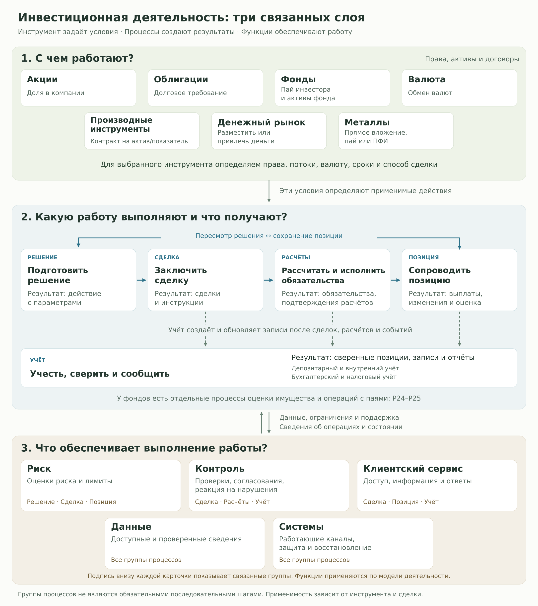
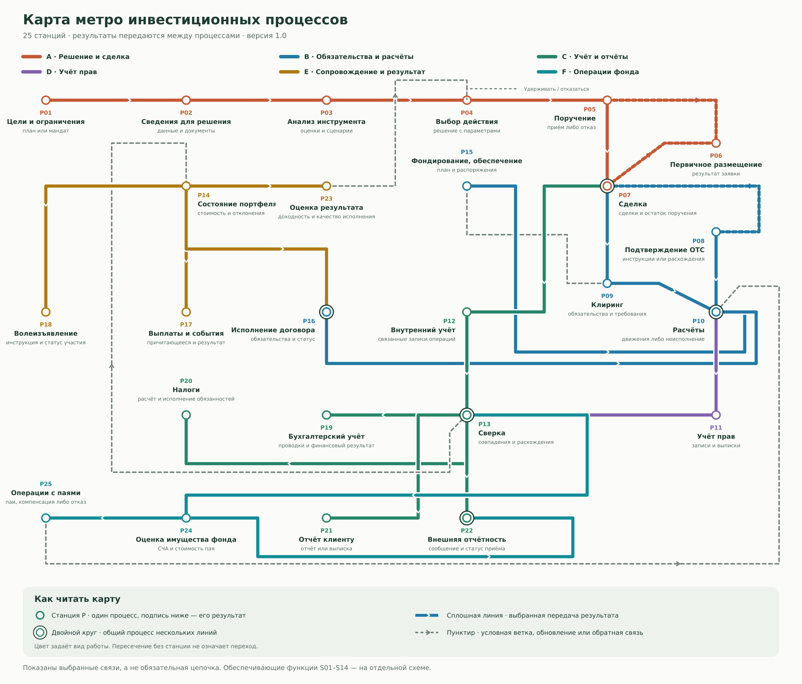
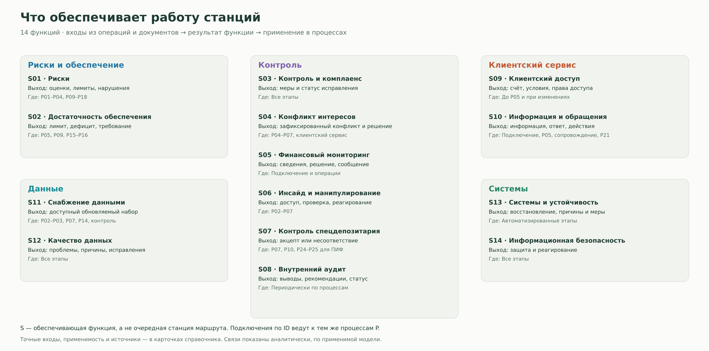

# Как устроена инвестиционная деятельность

[К рабочему маршруту команды](README.md)

Общий контекст команды «Инвест. Премаркет» · Основа: [исследование от 8 ноября 2026 года](report.md).

[Саммари](#summary) · [Обзорная карта](#overview) · [Сквозной пример](#example) · [Навигация](#navigation) · [Карта метро](#metro) · [Отчёт и источники](#research)

## 1. Коротко об исследовании

Инвестиционная деятельность начинается с целей, информации и решения, а продолжается после заключения сделки: нужно исполнить обязательства, учитывать активы, получать выплаты и пересматривать позиции. Вместе с этим работают риск, контроль, клиентский сервис, данные и системы.

Исследование описывает пространство, в котором команда будет искать продуктовую задачу. В охвате семь областей: акции, облигации, фонды, валюта, производные инструменты, денежный рынок и металлы. Основной контекст российский, рассматриваются биржевые и внебиржевые операции.

**Три опорные мысли:**

- **Инструмент, подход и процесс отвечают на разные вопросы.** Облигация описывает приобретаемое право, хеджирование означает цель снижения риска, а исполнение поручения является действием.
- **Сделка создаёт дальнейшую работу.** Определение обязательств, движение денег и бумаг, запись прав и сверка данных дают разные результаты.
- **Работа с инвестициями шире торговли.** Карта сохраняет задачи управления портфелем, расчётов, учёта, контроля, сервиса и инженерного сопровождения.

В справочнике выделены **25 основных процессов и 14 обеспечивающих функций**. Это аналитическая карта для исследования задач, а не единый обязательный регламент. Наличие процесса ещё не доказывает пользовательскую проблему, спрос или необходимость AI.

## 2. Обзорная карта

**Свойства инструмента задают применимые действия. Процессы передают результаты друг другу. Обеспечивающие функции дают сведения, ограничения и поддержку и получают данные о выполненной работе.**

[Открыть карту крупно](assets/overview.svg)

### Как связаны три слоя

1. **С чем работают?** В верхнем слое выбираем инструмент или область. Из его условий берём права, денежные потоки, валюту, сроки и способ сделки. Например, облигация задаёт требования к выплатам, а производный контракт может создавать будущие денежные или поставочные обязательства.
2. **Что делают и что получают?** В среднем слое эти условия превращаются в решение, сделку, обязательства, расчёты и сопровождение. Учёт получает сведения о сделках и событиях по мере их возникновения. Новые события и оценки могут вернуть работу к решению.
3. **Что позволяет выполнять работу?** Нижний слой связан со средним в обе стороны. Например, риск получает позиции и цены и возвращает оценки и лимиты. Контроль получает документы и операции и возвращает согласования, выявленные несоответствия и меры. Сервис обеспечивает доступ и ответы, данные и системы поддерживают выполнение процессов.

Подписи в нижних карточках показывают точки применения функций. Одна функция может обслуживать несколько групп процессов.

**Области верхнего слоя пересекаются.** Пай фонда описывает вложение инвестора, а облигации внутри фонда являются активами, с которыми работает управляющая компания. Аналогично валютный фьючерс относится к ПФИ, а валютный курс является его базовым показателем.

Стрелки показывают выбранные связи, а не единый обязательный порядок. Решение может состоять в сохранении позиции. У фондов отдельно возникают [оценка имущества и стоимости пая P24](processes.md#p24) и [выдача, обмен или погашение паёв P25](processes.md#p25).

## 3. Как это работает на примере

**Ситуация:** управляющая компания (УК) покупает облигацию на вторичном биржевом рынке для портфеля паевого инвестиционного фонда (ПИФ). Цель состоит в размещении части средств с учётом ограничений фонда.

Это условный учебный пример успешной сделки с клирингом. Он иллюстрирует связи процессов и не описывает регламент конкретной компании.

| Что происходит | Какой результат появляется | Кто или что использует его дальше |
|---|---|---|
| **1. Подготовка решения.** Изучаются выпуск, выплаты, текущий портфель и ограничения. [P01–P04](processes.md#p01) | Решение о покупке: инструмент, объём и допустимые условия | Подготовка поручения и проверки допустимости |
| **2. Поручение.** Брокеру передаются параметры операции. [P05](processes.md#p05) | Зарегистрированное поручение со статусом приёма. В примере оно принято | Исполнение поручения |
| **3. Сделка.** Находится встречное предложение и фиксируются условия. [P07](processes.md#p07) | Запись о сделке: бумага, количество, цена и время | Клиринг и внутренний учёт |
| **4. Клиринг.** Определяется, что, сколько и к какому сроку должны исполнить стороны. [P09](processes.md#p09) | Обязательства и требования по деньгам и бумагам | Расчётная функция |
| **5. Расчёты.** Исполняются денежные и поставочные обязательства. [P10](processes.md#p10) | Подтверждённые списания и зачисления | Учёт прав и обновление внутренних записей |
| **6. Учёт и сверка.** Записи о правах и операциях сопоставляются с внешними документами. [P11–P13](processes.md#p11) | Позиция в облигации, сверенные записи либо перечень расхождений для исправления | Оценка имущества фонда и отчётность |
| **7. Сопровождение.** Оценивается позиция и обрабатываются выплаты по бумаге. [P14](processes.md#p14), [P17](processes.md#p17), [P24](processes.md#p24) | Актуальная оценка, сведения о выплатах и обновлённые данные об имуществе фонда | Следующее инвестиционное решение, учёт и отчёты |

### Что здесь идёт параллельно

- **Учёт начинается по событиям.** После заключения сделки появляется запись внутреннего учёта. Результаты расчётов позднее обновляют её. Поэтому «сделка», «расчёт» и «учёт» не являются одной операцией.
- **Обеспечивающие функции участвуют на нескольких шагах.** Риск даёт оценки и ограничения. Контроль проверяет допустимость операции и необходимые согласования. Клиентский сервис обеспечивает обмен условиями и разбор обращений. Качественные данные и работающие системы нужны и для исходной оценки, и для последующей сверки.
- **Сопровождение может снова задействовать расчёты и учёт.** Например, выплата купона относится к уже открытой позиции и не требует новой покупки облигации.

### Как пример связывает слои карты

**Облигация** в верхнем слое задаёт долговое требование и условия выплат. **Средний слой** превращает решение в сделку, исполненные обязательства и учтённую позицию. **Нижний слой** предоставляет необходимые сведения, ограничения, проверки и каналы работы, а затем получает данные о выполненных операциях.

Покупка облигации меняет имущество фонда. Пайщик продолжает владеть **паем**, а приобретённая облигация является активом фонда. Это две связанные стороны коллективного вложения.

## 4. Навигация по областям и процессам

**Выберите удобную точку входа.** P обозначает основной процесс, S обозначает обеспечивающую функцию. В каждой карточке справочника есть вход, конкретный результат, применимость и источники.

### По области

| Область | На что обратить внимание | Перейти к процессам |
|---|---|---|
| **Акции** | Анализ эмитента, приобретение, права и корпоративные события | [Анализ P03](processes.md#p03) · [Сделка P07](processes.md#p07) · [Права P11](processes.md#p11) · [Выплаты P17](processes.md#p17) · [Права P18](processes.md#p18) |
| **Облигации** | Условия выпуска, выплаты, погашение и размещение | [Анализ P03](processes.md#p03) · [Размещение P06](processes.md#p06) · [Сделка P07](processes.md#p07) · [Выплаты P17](processes.md#p17) |
| **Фонды** | Различать пай инвестора и операции с имуществом фонда | [Оценка имущества P24](processes.md#p24) · [Операции с паями P25](processes.md#p25) · [Портфель P14](processes.md#p14) |
| **Валюта** | Суммы, валюты и даты обмена, связанные обязательства | [Сделка P07](processes.md#p07) · [Расчёты P10](processes.md#p10) · [Исполнение договора P16](processes.md#p16) |
| **ПФИ** | Спецификация, обеспечение, переоценка и исполнение | [Обеспечение P15](processes.md#p15) · [Исполнение P16](processes.md#p16) · [Достаточность покрытия S02](processes.md#s02) |
| **Денежный рынок** | Потребность в деньгах, срок финансирования, обеспечение и возврат | [Фондирование P15](processes.md#p15) · [Исполнение P16](processes.md#p16) · [Расчёты P10](processes.md#p10) |
| **Металлы** | Различать прямое вложение, пай и производный контракт | [Сделка P07](processes.md#p07) · [Расчёты P10](processes.md#p10) · [Внутренний учёт P12](processes.md#p12) |

Это стартовые маршруты, а не исчерпывающие списки применимости. Общие процессы и обеспечивающие функции выбираются по инструменту, договору и модели деятельности.

### По основной работе

<strong>Подготовить решение · P01–P04</strong>

- [P01. Определить цели и ограничения](processes.md#p01)
- [P02. Собрать сведения для решения](processes.md#p02)
- [P03. Оценить инструмент и варианты портфеля](processes.md#p03)
- [P04. Выбрать действие и параметры](processes.md#p04)

<strong>Подготовить и заключить сделку · P05–P08</strong>

- [P05. Оформить, зарегистрировать и проверить поручение](processes.md#p05)
- [P06. Подать и сопроводить заявку на размещение](processes.md#p06)
- [P07. Заключить сделку и обработать состояние поручения](processes.md#p07)
- [P08. Подтвердить параметры и расчётные инструкции](processes.md#p08)

<strong>Определить и исполнить обязательства · P09–P10</strong>

- [P09. Определить обязательства и требования по клирингу](processes.md#p09)
- [P10. Провести денежные и поставочные расчёты](processes.md#p10)

<strong>Сопроводить позицию и оценить результат · P14–P18, P23</strong>

- [P14. Оценить текущее состояние портфеля](processes.md#p14)
- [P15. Организовать фондирование и движение обеспечения](processes.md#p15)
- [P16. Обработать исполнение, перенос или прекращение договора](processes.md#p16)
- [P17. Обработать выплаты и обязательные изменения прав](processes.md#p17)
- [P18. Направить волеизъявление по корпоративному действию](processes.md#p18)
- [P23. Измерить результат портфеля и качество исполнения](processes.md#p23)

<strong>Учесть и сверить · P11–P13, P19–P20</strong>

- [P11. Зафиксировать права и движения по бумагам](processes.md#p11)
- [P12. Отразить операции во внутреннем учёте](processes.md#p12)
- [P13. Сопоставить внутренние и внешние записи](processes.md#p13)
- [P19. Отразить операции в бухгалтерском учёте](processes.md#p19)
- [P20. Определить и исполнить налоговые обязанности](processes.md#p20)

<strong>Подготовить и передать отчёты · P21–P22</strong>

- [P21. Передать отчёт клиенту](processes.md#p21)
- [P22. Подготовить регуляторные и репозитарные сведения](processes.md#p22)

<strong>Выполнить специальные операции фонда · P24–P25</strong>

- [P24. Оценить имущество, обязательства и расчётную стоимость пая](processes.md#p24)
- [P25. Выдать, обменять или погасить паи](processes.md#p25)

### По обеспечивающей функции

<strong>Риск · S01–S02</strong>

- [S01. Оценка и ограничение рисков](processes.md#s01)
- [S02. Контроль достаточности обеспечения](processes.md#s02)

<strong>Контроль · S03–S08</strong>

- [S03. Внутренний контроль и комплаенс](processes.md#s03)
- [S04. Урегулирование конфликта интересов](processes.md#s04)
- [S05. Финансовый мониторинг](processes.md#s05)
- [S06. Контроль инсайдерской информации и манипулирования](processes.md#s06)
- [S07. Контроль специализированного депозитария](processes.md#s07)
- [S08. Внутренний аудит](processes.md#s08)

<strong>Клиентский сервис · S09–S10</strong>

- [S09. Оформление клиентского доступа](processes.md#s09)
- [S10. Информирование и работа с обращениями](processes.md#s10)

<strong>Данные · S11–S12</strong>

- [S11. Снабжение рыночными и справочными данными](processes.md#s11)
- [S12. Проверка качества данных и исправление ошибок](processes.md#s12)

<strong>Системы · S13–S14</strong>

- [S13. Сопровождение систем и восстановление процессов](processes.md#s13)
- [S14. Информационная безопасность](processes.md#s14)

### Краткий словарь

<strong>Пояснения терминов</strong>

| Термин | Простое объяснение |
|---|---|
| **Позиция** | Учитываемое количество актива или состояние открытого контракта на определённый момент |
| **Поручение** | Указание клиента брокеру совершить определённые операции |
| **Торговая заявка** | Предложение условий сделки в выбранном механизме торгов. Одно поручение может исполняться через несколько заявок и сделок |
| **Сделка** | Согласованные условия, из которых возникают права и обязательства |
| **Клиринг** | Определение обязательств и требований по правилам соответствующей системы, по применимости с их взаимным зачётом |
| **Расчёты** | Исполнение обязательств, включая движение денег и поставляемых активов |
| **Учёт прав** | Записи о принадлежности ценных бумаг и ограничениях распоряжения ими |
| **Сверка** | Сопоставление записей и документов для подтверждения совпадений и обнаружения расхождений |
| **Обеспечение** | Деньги или иные допустимые активы, предоставленные для покрытия обязательств |
| **ПФИ** | Производный финансовый инструмент: контракт, условия которого зависят от базового актива или показателя |
| **ПИФ / пай / УК** | Паевой инвестиционный фонд, участие инвестора в его имуществе через пай и управляющая этим имуществом компания |
| **СЧА / РСП** | Стоимость чистых активов фонда и расчётная стоимость инвестиционного пая. РСП отличается от цены пая на бирже |

[Открыть весь справочник процессов](processes.md)

## 5. Карта метро процессов

**Следуйте за результатом работы: где он появляется, кому нужен дальше и что может вернуть процесс к решению.** Цвет обозначает вид работы, а ID станции соответствует карточке из справочника. Перейти к ней можно по ссылкам под картой или через [указатель всех станций](metro.md#stations).

[Открыть карту крупно в SVG](assets/metro-map.svg) · [Подробная легенда, станции и условия связей](metro.md)

### Легенда

| Обозначение | Как читать |
|---|---|
| **Круг P** | Один основной процесс. Подпись под названием показывает его результат |
| **Двойной круг** | Общий процесс нескольких линий. Он выполняет одну работу и передаёт результаты в разные контуры |
| **Сплошная цветная линия со стрелкой** | Выбранная передача результата между процессами |
| **Цветной пунктир** | Ветка, применимая при определённых условиях, например первичное размещение или отдельное подтверждение OTC-сделки |
| **Серый пунктир** | Передача данных, обновление состояния или обратная связь |
| **Пересечение без станции** | Перехода между линиями в этой точке нет |
| **Блок S на схеме поддержки** | Обеспечивающая функция и процессы, к которым она подключается |

### С чего начать чтение

- **От решения до позиции в ценных бумагах:** [P04](processes.md#p04) → [P05](processes.md#p05) → [P07](processes.md#p07) → [P09](processes.md#p09) → [P10](processes.md#p10) → [P11](processes.md#p11) → [P13](processes.md#p13). Это пример сделки с клирингом. Параллельная ветка [P07 → P12 → P13](metro.md#accounting) показывает внутренний учёт.
- **После покупки:** [P14](processes.md#p14) → [P17](processes.md#p17) для выплат и событий либо [P14](processes.md#p14) → [P23](processes.md#p23) → [P04](processes.md#p04) для оценки результата и пересмотра решения. Новая сделка требуется не всегда.
- **Для фонда:** [P13](processes.md#p13) → [P24](processes.md#p24) даёт данные для оценки имущества. Стоимость пая используется в [P25](processes.md#p25) при наличии заявки и в [P22](processes.md#p22) для применимых сообщений. Вторичная торговля паем относится к [P07](processes.md#p07).

### Где подключаются обеспечивающие функции

Риск, контроль, сервис, данные и системы работают поперёк маршрутов. Например, [S02](processes.md#s02) даёт лимит или требование, [P15](processes.md#p15) организует покрытие, а [P10](processes.md#p10) исполняет движение. Это три разных результата.

<strong>Схема подключения всех 14 обеспечивающих функций</strong>

[Открыть схему крупно](assets/metro-support.svg) · [Перейти к функциям и карточкам](metro.md#functions)

На рисунке показаны выбранные связи. Условия и две дополнительные связи обновления вынесены в [таблицу передач результатов](metro.md#connections). Карта описывает устройство работы по исследованию, а не обязательный порядок для каждого инструмента или регламент конкретного участника.

## 6. Полный отчёт и источники

**Для углубления выберите нужный материал.** Входная страница даёт общий контекст, а подробные основания и границы выводов находятся в отчёте и карточках.

| Материал | Когда открывать |
|---|---|
| **[Полный исследовательский отчёт](report.md)** | Нужны метод классификации, подробности по семи областям, пересечения, границы охвата и открытые вопросы |
| **[Справочник процессов и функций](processes.md)** | Нужно разобрать конкретную работу: её вход, результат, применимость и источники. В справочнике 25 процессов P и 14 функций S |
| **[Путеводитель по карте метро](metro.md)** | Нужно понять передачу результатов между процессами, пересадки и условия отдельных связей |
| **[Указатель 52 источников](sources.md)** | Нужно найти первоисточник по коду R, понять его роль в исследовании или перейти к использующим его карточкам |

### Как проверить конкретный вывод

1. Найдите нужный процесс или функцию по ID. Например, [P08](processes.md#p08) описывает подтверждение параметров и согласование расчётных инструкций.
2. Откройте указанный источник. Для P08 это [R18](sources.md#r18), материал НРД об электронном мэтчинге. В указателе сохранены название, ссылка и роль источника в исследовании.
3. Сопоставьте утверждение с документом и его областью применения: кто выполняет работу, для каких инструментов и договоров, в какой редакции. Для проверки статуса стандартов в отчёте указан [реестр ЦБ R45](sources.md#r45).

### Какой статус у выводов

- **Описание операций и условий** опирается на приведённые источники. Материалы конкретного участника показывают его практику в обозначенных условиях.
- **Группировка, названия результатов и связи на картах** являются аналитическим сведением этих материалов. Условия переходов раскрыты в [таблице связей](metro.md#connections).
- **Пользовательские проблемы и продуктовые гипотезы** требуют дальнейшей проверки с конкретными исполнителями. Карта сама по себе не подтверждает частоту затруднений, спрос или пользу AI.

**Дата проверки источников в исходном отчёте: 8 ноября 2026 года.** При применении карты к конкретной ситуации уточняйте действующую редакцию документа, адресатов и условия операции. Особенности актуальности и ограничения исследования раскрыты в полном отчёте.
