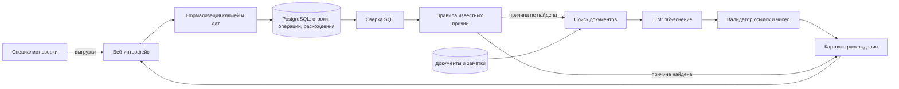

# Продукт B: данные, модели, схема и стоимость

[Обзор B](README.md) · [Продукт и сценарий](product.md) · [Проверка и риски](evaluation.md) · [Черновик заявки](application.md)

Предполагаемый MVP. Разработка не выполнялась, данные не получены.

## Данные (№3)

| Данные | Источник | Формат и поля | Обновление | Доступность |
|---|---|---|---|---|
| Внутренний регистр | Бэк-офис брокера | Таблица: счёт, раздел, ISIN, количество, дата и момент учёта | Ежедневно или по регламенту сверки | **Неизвестно**, нужен партнёр |
| Депозитарная выписка | Депозитарий брокера или НРД | Отчёт об остатках по счёту и разделу, в электронном документообороте или ISO 15022 | Ежедневно | **Неизвестно**, нужен партнёр |
| Операции и статусы | Бэк-офис брокера | Поручения, сделки, расчёты, корпоративные действия со статусами и датами | По событию | **Неизвестно** |
| Первичные документы и заметки | Бэк-офис, переписка разбора | PDF, текст | По событию | **Неизвестно**, содержат данные клиентов |
| Справочник ключей | Брокер, [описание НРД](https://www.nsd.ru/services/depozitariy/obsluzhivanie-aktivov/otkrytie-i-zakrytie-schetov-depo/dopolnitelnye-identifikatory/) | Соответствие счетов, разделов и дополнительных идентификаторов | При изменении | Публичное описание **доступно**, данные брокера нет |

**Ограничения.** Все рабочие данные являются конфиденциальными данными клиентов. Для эксперимента нужно обезличивание с сохранением связей. Синтетические данные проверяют код, но не реальную причину расхождения.

## AI-подходы и модели (№23)

**Выбор:** LLM, RAG.

LLM нужна только для шага 6: объяснить причину по текстам документов и заметок, когда правила причину не нашли. RAG ограничивает её документами по конкретному расхождению. Классическое ML не используется, поскольку размеченных случаев нет. Агентный контур не нужен, шаги фиксированы.

Кандидаты моделей те же, что для A: GigaChat, YandexGPT или Qwen3 на собственном сервере. Для данных клиентов брокера вероятнее вариант внутри контура. Модель не выбрана.

**Объяснение для поля 6:**

> Сверку, расчёт различий и проверку известных причин выполняют SQL и правила. LLM нужна только для расхождений, которые правила не объяснили: она читает документы и заметки по операциям и предлагает причину. RAG ограничивает её документами конкретного случая, поэтому каждое объяснение ссылается на источник.

## Схема MVP (№24)

**Границы MVP.** Одна бумага и один счёт за раз, загрузка выгрузок вручную, никакой записи в регистр.

## Стоимость (№35)

`Токены на расхождение = d × f + s + o`: d документов по 1 000 токенов, инструкция s = 1 000, ответ o = 500. При d = 10 выходит 11 500 токенов, то есть около 6-14 ₽ на одно расхождение по тарифам GigaChat Pro и YandexGPT Pro ([оценка тарифов](https://github.com/vafaevelshodbek-png/invest-premarket/blob/docs/product-a-application/docs/product/system.md#cost)). LLM вызывается только для расхождений без причины после правил, их доля неизвестна.

**Стоп-факторы.** Данные нельзя вывести из контура брокера, а собственный сервер недоступен. Или почти все расхождения закрываются правилами, и LLM не нужна.
