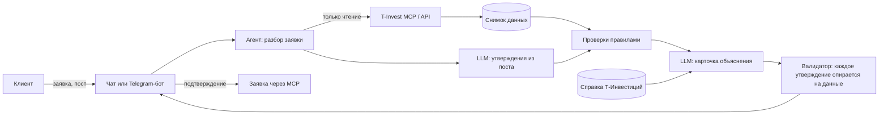

# Система: данные, модели, схема и стоимость

[Итерация З](README.md) · [Идеи](ideas.md) · [Концепция](concept.md) · [Проверка и риски](evaluation.md) · [Черновик заявки](application.md)

Предполагаемый MVP под [концепцию](concept.md) от 14 ноября 2026 года. Разработка не выполнялась, модели и API не вызывались. Подробную спецификацию данных ведёт [№3](https://github.com/vafaevelshodbek-png/invest-premarket/issues/3), здесь только входы, нужные для схемы.

## Входы (для №3)

| Данные | Источник | Обновление | Ограничения |
|---|---|---|---|
| Параметры заявки | Клиент или его агент | На каждую сделку | Свободный текст требует уточнения |
| Бумага: тип, флаги амортизации, плавающего купона, бессрочности, субординации, уровень риска, только для квалифицированных | T-Invest API, `Bond` и каталоги | Справочник, раз в день | Покрытие полей не проверено |
| События облигации: купоны, оферты, погашение, конвертация, дефолт | `GetBondEvents` | По событию | В песочнице выплаты не начисляются |
| Свечи и объёмы | `GetCandles`, архивы свечей | Минуты и дни | Лимиты запросов |
| Сделки инсайдеров | `GetInsiderDeals` | По событию | Покрытие эмитентов не проверено |
| Календарь отчётности | `GetAssetReports` | По событию | Только даты, без содержания отчёта |
| Портфель и операции клиента | `GetPortfolio`, `GetOperationsByCursor` | На каждую проверку | Нужен токен клиента |
| Текст поста | Клиент | По желанию | Недоверенные данные, только как вход для проверки |

Методы взяты из [официальных контрактов](https://github.com/RussianInvestments/investAPI/tree/main/src/docs/contracts). Наличие метода в API не доказывает его наличие в MCP: до разработки нужен `tools/list` MCP и пробные вызовы токеном только на чтение. Данные используются от имени клиента, ретрансляция ограничена [FAQ API](../../../research/invest-api/README.md).

## AI-подходы и модели (№23)

**Выбор из формы:** AI-агент, LLM, RAG.

| Подход | Зачем | Почему не проще |
|---|---|---|
| AI-агент | Понять заявку и пост в свободной форме, выбрать нужные чтения через MCP | Набор проверок зависит от бумаги и вопроса клиента |
| LLM | Выделить утверждения из поста, объяснить последствия простыми словами в контексте конкретной заявки | Шаблон не связывает несколько находок с параметрами сделки и не разбирает текст поста |
| RAG | Подтягивать определения и правила из справки Т-Инвестиций и условия выпуска | Чтобы объяснение опиралось на источник, а не на память модели |

Не используются: классическое ML и прогнозные модели (нет размеченных данных и прогноз цены вне сценария), multi-agent (одна последовательность шагов).

**Требования к модели.** Русский язык, вызов инструментов, структурированный ответ, контекст не меньше 32 тысяч токенов. Кандидаты: GigaChat ([тарифы](https://developers.sber.ru/docs/ru/gigachat/tariffs/legal-tariffs)), YandexGPT ([тарифы](https://yandex.cloud/ru/docs/foundation-models/pricing)), Qwen3 на своём сервере ([модели](https://huggingface.co/Qwen)). Модель выбирается по пилоту, до этого не выбрана.

**Объяснение для поля 6** (≤400 знаков):

> Агент понимает заявку и пост клиента и выбирает чтения через MCP. Проверки правилами делает код: события облигации, всплеск объёма, доля в портфеле, срок владения. LLM выделяет утверждения из поста и объясняет найденное простыми словами. RAG подтягивает правила из справки. Каждый вывод сверяется с данными.

## Схема MVP (№24)

| Компонент | Шаг сценария | Хранит состояние |
|---|---|---|
| Чат или Telegram-бот | 1, 8 | Сессия клиента |
| Агент | 2, 3 | Нет |
| MCP / API адаптер | 3, 8 | Нет |
| Снимок данных | 3 | Временное хранилище на одну проверку |
| Проверки правилами | 4 | Пороги и настройки |
| LLM для поста и карточки | 5, 6 | Журнал запросов |
| Справка | 6 | Векторный индекс справки и условий выпуска |
| Валидатор | 7 | Журнал отброшенных утверждений |

**Границы MVP.** Песочница для заявок, токен только на чтение для рыночных данных, облигации и акции, 5-6 проверок правилами. **Вне MVP:** встраивание в приложение Т-Инвестиций, деривативы, маржинальная торговля.

**Отказы** описаны в [шагах сценария](concept.md#steps).

## Стоимость и осуществимость (№35)

`Токены на проверку = вход заявки и данных (≈4 000) + пост (до 2 000) + справка (≈3 000) + ответ (≈800)`, итого около 10 000 токенов.

| Модель | Цена за 1 000 токенов | Одна проверка | 1 000 проверок |
|---|---|---|---|
| GigaChat Pro | 0,5 ₽ | ≈5 ₽ | ≈5 000 ₽ |
| YandexGPT Pro | 1,20 ₽ | ≈12 ₽ | ≈12 000 ₽ |

Цены по страницам тарифов на 10 ноября 2026 года, перед оплатой сверить. Вызовы API бесплатны в пределах лимитов.

**Работы до MVP:** подключить MCP и проверить `tools/list`, написать 5-6 проверок, собрать набор примеров, сделать чат-интерфейс. По оценке, это реально вчетвером за 10 дней SYSTEM BUILD. Занятость участников не измерялась.

**Стоп-факторы.** В MCP или для токена клиента нет нужных методов и их нельзя заменить API. Проверка занимает больше 10 секунд. Стоимость одной проверки сопоставима с комиссией за сделку.
