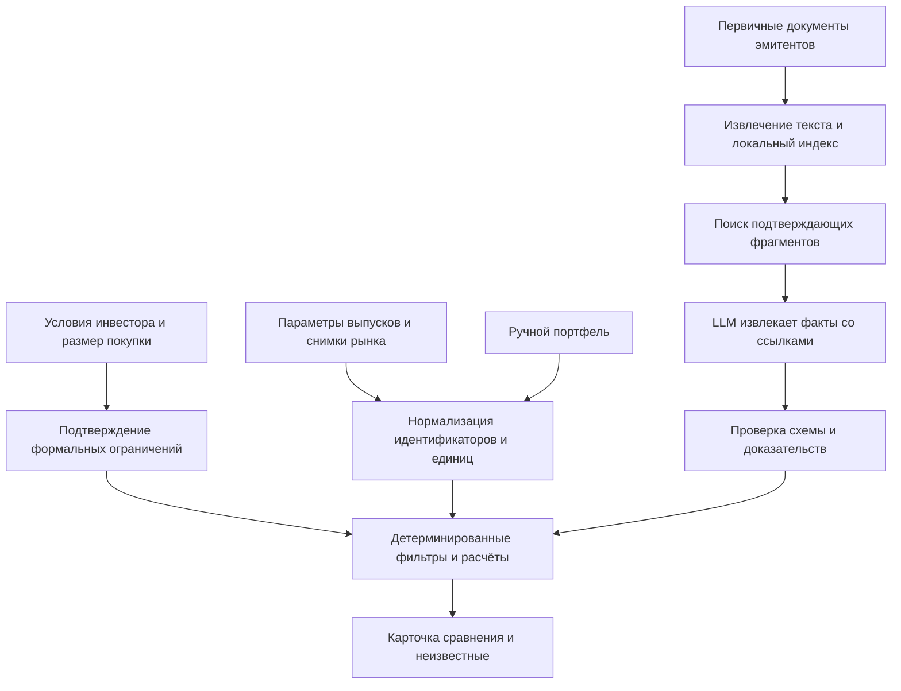

# Система и роль ИИ

Проектная спецификация для [№23](https://github.com/vafaevelshodbek-png/invest-premarket/issues/23), [№24](https://github.com/vafaevelshodbek-png/invest-premarket/issues/24) и технической части [№22](https://github.com/vafaevelshodbek-png/invest-premarket/issues/22). Дата: 16 ноября 2026 года. [Данные](data.md), [стоимость](costs.md), [обзор](README.md).

## Решение для первого отбора

Предполагаемый продукт принимает условия инвестора, сравнивает два выпуска из ограниченного каталога, показывает подтверждённые факты об эмитентах и изменение концентрации после заданной покупки. Карточка содержит проверяемые факты, числа, источники, время снимка и неизвестные. Она не является кредитным рейтингом, прогнозом доходности или распоряжением брокеру. Разработка MVP в рамках этого PR не заявляется.

Для формы выбираются **LLM и RAG**. LLM нужен для перевода неоднозначного запроса в видимые ограничения, извлечения фактов из разных текстов и подготовки связного объяснения. RAG здесь означает поиск по заранее полученным документам с привязкой каждого факта к конкретному фрагменту. Все арифметические и логические проверки выполняются программным модулем. Автономный агент и несколько агентов в составе продукта не требуются: последовательность действий заранее ограничена, модель не получает право сама менять источники, условия пользователя или счёт. Организация исследовательской работы несколькими агентами не является архитектурой будущего продукта.

Правила, поиск по словам и таблица являются сильной альтернативой. Для небольшого стабильного набора выпусков заполненный вручную шаблон может оказаться дешевле и надёжнее LLM. Поэтому необходимость ИИ является проверяемым предположением. В эксперименте сравниваются сквозной вариант с ИИ, тот же интерфейс без LLM, где пользователь сам извлекает и переносит факты, и обычный ручной способ. Во втором условии готовые ответы заранее не подставляются. Выигрыш только от удобного экрана не будет приписан модели. [План проверки](experiment.md).

## Схема компонентов

Схема показывает поток данных, а не созданное приложение. В ней нет торгового исполнителя. Опциональный адаптер T-Invest читает сведения об инструментах и портфеле вместо части ручного входа, но не меняет проверяющую логику. Схемы методов подтверждены официальными [контрактами T-Invest](https://github.com/RussianInvestments/investAPI/tree/main/src/docs/contracts). Работоспособность авторизованного подключения не проверена.

## Пошаговый поток

1. Пользователь задаёт валюту, горизонт, купон, бюджет и допустимую концентрацию. LLM может предложить заполненные поля, но человек подтверждает их до отбора. «До трёх лет» фиксируется точной датой, «надёжные» требует уточнения. Новое условие из объяснения модели не добавляется скрытно.
2. Сервер связывает ISIN с выпуском, юридическим эмитентом, группой и сектором. Отдельно проверяет ограничения продукта и пригодность источников. Неквалифицированность пользователя и доступность у брокера не выводятся из факта наличия бумаги в биржевом каталоге.
3. Обычный код проверяет фильтры и формирует список подходящих выпусков. Отсутствующее обязательное значение означает «не установлено», а не «подходит». Если ни один выпуск не соответствует условиям, результатом служит объяснение нарушений. Условия не ослабляются автоматически.
4. Из локального корпуса выбираются фрагменты отчётности и событий для двух сравниваемых эмитентов. LLM возвращает JSON с фактами, документом, страницей, периодом, единицами и ограничениями. Отдельный проверяющий модуль сопоставляет ссылку с загруженным документом и проверяет типы. Одна повторная генерация разрешена при ошибке схемы, затем модуль отказывает в неподтверждённом блоке.
5. Числа из подтверждённых фактов проходят нормализацию и контроль сопоставимости. Финансовые отношения рассчитывает обычный код только при наличии согласованных числителя и знаменателя. Показатель, рассчитанный по неполной отчётности, не становится оценкой дефолта. Для банков, холдингов и несопоставимых периодов отдельные коэффициенты отключены.
6. Калькулятор вычисляет ориентировочную стоимость заданного количества бумаг и изменение концентрации в переданном портфеле. Результат отмечает источник финансирования, комиссию, дату и семантику цены. При отсутствии совместимой цены и НКД выводится только сценарий с явно заданными пользователем ценами.
7. Шаблон карточки собирает результаты фильтров, факты, риски и ограничения. LLM может переформулировать объяснение, но не изменяет числовые поля. Человек видит ссылки на первичные источники и решает, изучать ли документ дальше, менять ли условия или самостоятельно переходить в брокерский интерфейс.

## Точная граница вычислений

Стоимость одной обычной рублевой облигации при известном номинале `N`, котировке в процентах `p` и совместимом НКД `a` рассчитывается как `p / 100 × N + a`. Для `q` бумаг: `q × (p / 100 × N + a) + комиссия`. Количество в штуках равно `число лотов × размер лота`. Такой перевод соответствует [описанию котировок T-Invest](https://developer.tbank.ru/invest/services/quotes/head-marketdata). В [data.md](data.md#реальный-публичный-пример) есть реальный пример единиц и причины, по которым этот снимок нельзя выдавать за исполнимую цену.

НКД берётся из согласованного источника на нужную дату расчётов. Он не генерируется моделью и не переносится автоматически с сегодняшней даты на T+1. Самостоятельный расчёт НКД допустим только при известных условиях купонного периода, конвенции и календаре. Аналогично нельзя называть купонную ставку доходностью к погашению. У сложных выпусков прогнозные купоны, оферты и налоговые условия меняют смысл показателя. Для первого отбора собственная модель доходности не нужна. [Калькулятор и ограничения МОЕХ](https://www.moex.com/ru/bondization/calc), [пояснения по облигациям Т-Банка](https://www.tbank.ru/invest/help/educate/how-it-works/ways-to-invest/bonds-profit/).

Стоимость позиции оценивается одной выбранной методикой для всего набора. Если используется грязная стоимость облигаций, НКД включается один раз. Доля юридического эмитента равна сумме стоимости его позиций, делённой на стоимость всех переданных активов с денежным остатком. Групповая концентрация показывается отдельно, когда связь с группой подтверждена. Название бренда недостаточно для объединения долгов разных юридических лиц.

При покупке из уже учтённых денег номинальный размер портфеля не увеличивается на сумму покупки. Денежный остаток уменьшается на покупку и комиссию, стоимость новой позиции добавляется на той же оценочной базе. Если разница цены исполнения и оценки не учитывается, знаменатель после сделки равен исходной стоимости минус комиссия. При новом внешнем пополнении знаменатель увеличивается на пополнение. Система обязана уточнить этот выбор. Иначе формально правильная дробь даёт неверную концентрацию.

Учебный пример, все числа вымышлены: портфель 1 000 000 рублей включает 200 000 рублей cash, позиция эмитента до покупки 80 000 рублей. Покупка на 50 000 рублей из имеющегося cash, без комиссии и переоценки, меняет долю с 8% до 13%, а cash с 200 000 до 150 000. Знаменатель остаётся 1 000 000. При внешнем пополнении на 50 000 и последующей покупке доля была бы 130 000 / 1 050 000, около 12,38%. Это пример арифметики, не инвестиционное предложение.

## Модели и критерий выбора

Основной кандидат для первой проверки: `gpt://<идентификатор_каталога>/yandexgpt-5.1`, YandexGPT Pro 5.1. Контрольный кандидат меньшей стоимости: `gpt://<идентификатор_каталога>/aliceai-llm-flash`. В текущем [каталоге AI Studio](https://aistudio.yandex.ru/ru/docs/ai-studio/concepts/generation/models) для них указаны контексты 32 768 и 65 536 токенов. Обе модели выбраны как кандидаты доступного российского облачного контура, их качество на облигационных документах и рабочий доступ команды не проверены.

Проверка выбора проводится на одном корпусе с фиксированными промптами и одинаковыми вопросами. Требуются русский язык, вывод по заданной схеме, корректное сохранение периода и единиц, точные ссылки, явный отказ при нехватке источника. Побеждает модель, которая выполняет ограничения качества с меньшими фактическими расходами и временем ответа. Размер контекста и маркетинговые описания не доказывают пригодность. Для документов длиннее лимита используется извлечение нужных таблиц, без молчаливого усечения.

YandexGPT Lite 5 не выбран: в [актуальном каталоге](https://aistudio.yandex.ru/ru/docs/ai-studio/concepts/generation/models) опубликовано отключение 15 ноября 2026 года. Старые заметки о дешёвой Lite не являются основанием для новой архитектуры. Версия модели записывается явно, `latest` не используется как воспроизводимое имя.

Обучение своей модели, прогнозная модель, оптимизация портфеля, обработка речи и компьютерное зрение в первую версию не входят. Если исходный PDF не содержит пригодного текста, он сначала проходит проверку OCR или исключается. OCR не делает числа надёжными автоматически. Для маленького корпуса достаточно локального полнотекстового поиска с ранжированием по терминам и метаданным. Векторный индекс добавляется только если измеримый recall по нужным фактам хуже согласованного уровня. [Документация поиска AI Studio](https://aistudio.yandex.ru/ru/docs/ai-studio/concepts/search/).

## Состояние и хранилища

Для предполагаемого локального MVP достаточно файлового каталога первичных документов с SHA-256, SQLite для выпусков, фактов, расчётных снимков и истории карточек, а также полнотекстового индекса. Это проектный выбор, не требование API. В базе хранятся исходное значение, нормализованное значение и ссылка, а не только итоговый пересказ. Замена документа создаёт новую версию и делает прежние результаты проверяемыми.

Состояние запроса содержит подтверждённые ограничения, идентификаторы снимков, хеш портфеля, версию калькулятора, модель, промпт, найденные фрагменты, статус проверок и результат. Персональная часть портфеля остаётся в локальном контуре. В облако уходят публичные фрагменты и минимальные обезличенные условия. Числа итогового портфеля можно объяснить локальным шаблоном без передачи его состава LLM.

Отказ от логирования запросов не равен отсутствию любых сохранённых данных у провайдера. Политика AI Studio различает сервисные логи, трассы и объекты API. Для предполагаемой интеграции нужны отключённое использование содержимого для улучшения сервиса, `store: false` там, где API его поддерживает, и запрет сохранения чувствительных трасс. Это настраиваемые требования, не выполненная конфигурация данного PR. [Политика хранения](https://aistudio.yandex.ru/ru/docs/ai-studio/concepts/security/data-storage), [отключение логирования](https://aistudio.yandex.ru/ru/docs/ai-studio/operations/disable-logging).

## Критичные отказы

| Ситуация | Поведение системы | Что сохраняется в карточке |
|---|---|---|
| Выпуск не сопоставлен однозначно | Не выполнять сравнение по похожему названию | Неоднозначный идентификатор и нужное уточнение |
| Нет обязательного параметра или документа | Не отмечать выпуск подходящим | Конкретное недостающее поле и источник |
| РСБУ и МСФО либо периоды различаются | Не считать общий коэффициент | Два значения и причина несопоставимости |
| Ссылка модели не существует или число не совпадает | Удалить неподтверждённый факт из вывода, один ограниченный повтор | Отказ соответствующего блока |
| В PDF содержится инструкция агенту | Рассматривать её как текст источника | Никаких изменений системных правил или инструментов |
| Рыночная цена устарела, отсутствует ask или глубина | Показать сценарную оценку, не обещать цену исполнения | Timestamp, тип цены и ограничение |
| Портфель неполный | Не делать вывод обо всём капитале | Область переданного набора и неизвестные доли |
| Модель или API недоступны | Вернуть доступные таблицы и расчёты | Отсутствующий текстовый блок, без выдуманного объяснения |
| Превышены токены, повтор или денежный лимит | Остановить дополнительные вызовы | Частичный результат и причина остановки |

Документальные данные являются недоверенным содержимым. Модель не исполняет команды из PDF, сайтов и новостей. Список источников ограничен заранее проверенными адресами, внешние URL из текста не открываются автоматически. В API-адаптере разрешены только необходимые операции чтения. Реальные названия инструментов MCP и объём выдачи должны быть сверены при подключении, одного описания протокола недостаточно. [Спецификация инструментов MCP](https://modelcontextprotocol.io/specification/2025-06-18/server/tools).

## Условия осуществимости

Предполагаемая система технически ограничена и не требует обучения модели или торговой авторизации для первого документального сравнения. Главные зависимости: пригодный корпус, специалист для эталона, разрешённое использование материалов, доступ к модели и проверка семантики финансовых чисел. Ни чтение контрактов, ни реальный HTTP 200 не доказывают завершённый сквозной сценарий. Проверка другим техническим и финансовым участником остаётся условием принятия соответствующих задач, а не заявленным результатом агента.
