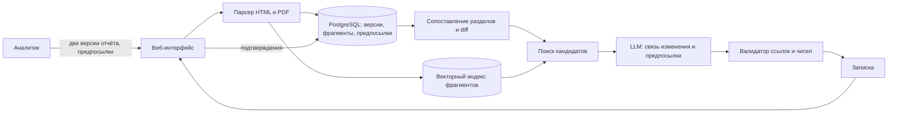

# Данные, модели, схема и стоимость

[Выбор и навигация](README.md) · [Продукт и сценарий](product.md) · [Проверка и риски](evaluation.md) · [Черновик заявки](application.md)

Материал от 10 ноября 2026 года для продукта A. Описывает предполагаемый MVP: разработка не выполнялась, модели не запускались, тарифы взяты из документации и выдержек поисковой выдачи.

## Спецификация данных (№3)

| Данные | Источник | Формат и поля | Обновление | Ограничения | Доступность |
|---|---|---|---|---|---|
| Отчётность эмитента, две версии | Сайты эмитентов, [Центр корпоративной информации Мосбиржи](https://www.moex.com/tsentr-korporativnoj-informatsii), порталы раскрытия | HTML или PDF. Нужны: отчёты о финансовом положении, прибылях и убытках, движении денег, примечания, дата публикации, период | По событию: квартальная, полугодовая и годовая отчётность | Неполнота раскрытия, пересчёт сравнительных данных, разная структура у разных эмитентов, сканы в PDF | **Доступно** для пары «Норникеля» 2023 и 2024 годов ([№19](../research/investment-processes/candidate-data-check.md#public-example)). Покрытие других эмитентов **не проверено** |
| Предпосылки модели аналитика | Аналитик УК, выгрузка из Excel | Таблица: название, значение, период, единица, источник в отчёте | При каждом пересмотре | Внутренние данные УК. Нужны разрешение на обработку и, возможно, развёртывание без внешней LLM | **Неизвестно.** Для эксперимента предпосылки составляет финансовый проверяющий команды по публичным отчётам |
| Эталонные связи | Проверяющий с финансовым профилем, позже подтверждения аналитиков | Таблица: предпосылка, фрагмент новой версии, фрагмент прежней версии, существенность | Составляется один раз для набора, затем копится из подтверждений | Субъективность. Нужны правила разметки и второй проверяющий на части примеров | **Нет**, создаётся в рамках [эксперимента](evaluation.md#baseline) |
| Справочник эмитента | [T-Invest API](../research/invest-api/README.md), метод инструментов | Тикер, ISIN, название | По запросу | Нужен токен. Для основного сценария не обязателен | **Документировано**, доступ аккаунта не проверен |

**Если данных нет.** Если пропал раздел, система сообщает о непрочитанном разделе и не делает выводов. Если предпосылок нет, работает в режиме «только изменения отчёта», то есть сводится к обычному сравнению, и прямо об этом говорит.

**Условия использования.** Для MVP файлы загружает сам пользователь. Автоматический сбор с порталов раскрытия не планируется, пока не проверены их условия. Ретрансляция данных T-Invest API ограничена [FAQ API](../research/invest-api/README.md).

## AI-подходы и модели (№23)

**Выбор из списка формы:** LLM, RAG.

| Подход | Зачем нужен | Почему достаточно |
|---|---|---|
| LLM | Связать изменение с предпосылкой при разных формулировках, отличить содержательное изменение от переформулировки | Эту работу не закрывают diff, поиск и правила без словаря под каждую модель ([№22](../research/investment-processes/candidate-ai-check.md#disclosure)) |
| RAG | Дать LLM только адресованные фрагменты двух версий и предпосылку, чтобы каждая связь ссылалась на источник | Отчёт целиком не нужен, поиск кандидатов выполняет код |

**Что не используется и почему.** AI-агент и multi-agent-система не нужны: последовательность шагов фиксирована и выполняется кодом. Классическое ML не используется, поскольку размеченного корпуса связей нет. Прогнозные модели не нужны: система ничего не прогнозирует.

**Требования к модели.** Русский язык и финансовая лексика, структурированный ответ (JSON со ссылками на фрагменты), контекст не меньше 32 тысяч токенов на один запрос, возможность размещения внутри контура УК для внутренних моделей.

| Кандидат | Документация | Что известно | Неизвестно |
|---|---|---|---|
| GigaChat Pro или Max, API | [Тарифы для юрлиц](https://developers.sber.ru/docs/ru/gigachat/tariffs/legal-tariffs) | С 1 февраля 2026 года 0,5 ₽ и 0,65 ₽ за 1000 токенов по выдержке официальной страницы | Качество на задаче, условия обработки внутренних данных УК |
| YandexGPT Pro, API | [Тарификация Yandex Cloud](https://yandex.cloud/ru/docs/foundation-models/pricing) | 1,20 ₽ за 1000 токенов синхронно на официальной странице. Для версии 5.1 Pro сторонние источники называют другие цены | Актуальная цена, качество на задаче |
| Qwen3 с открытыми весами на своём сервере | [Карточки моделей Qwen](https://huggingface.co/Qwen) | Лицензия Apache 2.0 по сторонним описаниям, запуск через vLLM | Нужный размер модели и GPU, качество на русском финансовом тексте |
| Модель эмбеддингов для поиска | Документация выбранного провайдера | Нужна для шага 5 | Конкретная модель не выбрана |

Конкретная модель выбирается по результатам [пилота на 5 парах](evaluation.md#experiment). До этого ответ «модель не выбрана» честнее любого названия.

**Объяснение для поля 6** (297 знаков):

> LLM нужна для смысловой связи изменений отчёта с предпосылками модели при разных формулировках. RAG ограничивает модель адресованными фрагментами двух версий отчёта и списком предпосылок, поэтому каждая связь проверяемо ссылается на источник. Извлечение, сравнение и расчёты выполняет обычный код.

## Схема MVP (№24)

| Компонент | Шаг сценария | Вход | Выход | Состояние |
|---|---|---|---|---|
| Веб-интерфейс | 1, 9 | Файлы, подтверждения | Задание, подтверждённая записка | PostgreSQL |
| Парсер | 2 | HTML, PDF | Адресованные фрагменты, таблицы | PostgreSQL, файловое хранилище исходников |
| Сопоставление и diff | 3, 4 | Фрагменты двух версий | Изменения, признаки пересчёта | PostgreSQL |
| Поиск кандидатов | 5 | Предпосылки, изменения | Кандидаты на каждую предпосылку | Векторный индекс |
| LLM | 6 | Предпосылка и кандидаты | Проект связей в JSON | Не хранит, журнал запросов в PostgreSQL |
| Валидатор | 7 | Проект связей | Подтверждённые связи, отброшенные с причиной | PostgreSQL |
| Сборка записки | 8 | Связи, изменения без связи | Записка | PostgreSQL |

**Внешние зависимости.** API выбранной LLM или собственный сервер с GPU, библиотеки извлечения текста из PDF и HTML, Python difflib для буквального сравнения. T-Invest API не обязателен.

**Границы MVP.** Один эмитент и одна пара версий за раз, загрузка файлов вручную, русский язык, отчётность МСФО. Сбор по расписанию, встраивание в терминалы и редактирование модели аналитика вне MVP.

**Отказы.** Описаны в [шагах сценария](product.md#steps). Технически: таймаут или лимит LLM приводит к выдаче результатов шагов 2-5 без связей, ошибка парсера приводит к пометке непрочитанного раздела.

## Стоимость и осуществимость (№35)

**Формула на один разбор:**

`Токены = Nп × (k × f + s + o)`, где Nп это число предпосылок, k число кандидатных фрагментов на предпосылку, f средний размер фрагмента, s размер инструкции, o размер ответа.

`Стоимость = Токены / 1000 × цена за 1000 токенов`

| Параметр | Предположение | Основание |
|---|---|---|
| Nп | 30 предпосылок | Предположение для модели одного эмитента, не измерено |
| k | 5 фрагментов | Выбор архитектуры |
| f | 800 токенов | Абзац или строка таблицы с контекстом, предположение |
| s | 1 000 токенов | Инструкция и формат ответа |
| o | 500 токенов | JSON со связями |

Итого 30 × (5 × 800 + 1 000 + 500) = **165 000 токенов** на разбор.

| Модель | Цена за 1000 токенов | Один разбор | Эксперимент: 15 пар, 3 прогона |
|---|---|---|---|
| GigaChat Pro | 0,5 ₽ | ≈ 83 ₽ | ≈ 3 700 ₽ |
| GigaChat Max | 0,65 ₽ | ≈ 107 ₽ | ≈ 4 800 ₽ |
| YandexGPT Pro | 1,20 ₽ | ≈ 198 ₽ | ≈ 8 900 ₽ |

Цены относятся к странице тарифов на дату чтения и требуют сверки перед оплатой. Эмбеддинги и сервер не учтены. Собственный сервер с GPU требует отдельной оценки аренды, она не выполнялась.

**Задержка.** 30 запросов к LLM можно выполнять параллельно в пределах лимитов провайдера. Лимиты не проверялись.

**Работы, требующие ресурсов.** Подготовка набора примеров и эталонных связей финансовым проверяющим является самой трудоёмкой частью. Занятость участников и бюджет команды неизвестны.

**Стоп-факторы.**
- Внутренние модели УК нельзя передавать внешней LLM, а собственный сервер недоступен по стоимости.
- Разбор одного отчёта стоит сопоставимо с часом работы аналитика или дороже.
- Время разбора выходит за пределы, приемлемые для аналитика. Этот порог нужно узнать в разговорах с аналитиками.
