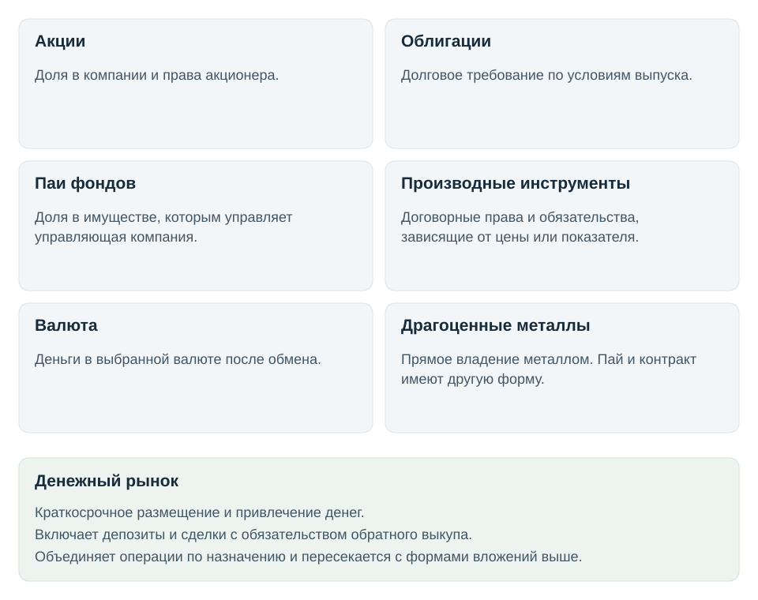
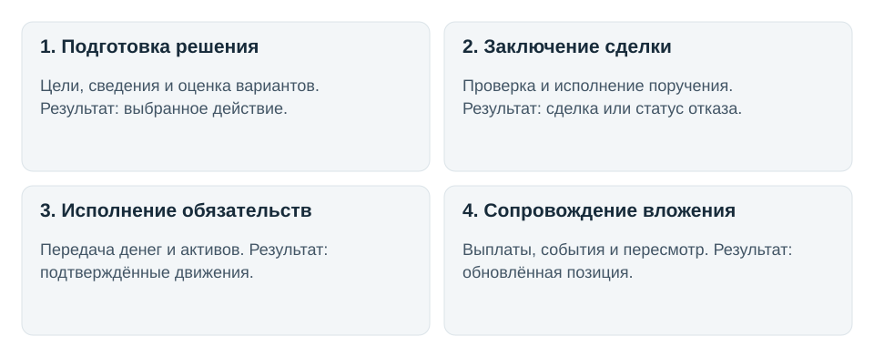

# Как устроена инвестиционная деятельность

Инвестор выбирает, куда вложить деньги и какой риск принять. После сделки нужно получить актив, учесть права, следить за изменениями и выплатами. Часть работы выполняет сам инвестор, часть берут на себя посредники и инфраструктура рынка.

## Во что вкладывают

Фонд может владеть акциями, облигациями или металлами, однако его инвестор владеет паем. Поэтому состав имущества фонда рассматривают отдельно от формы вложения.

Денежный рынок объединяет краткосрочное размещение и привлечение денег. Например, депозит создаёт требование к банку, а сделка продажи бумаг с обязательством обратного выкупа позволяет получить финансирование. Это назначение операций, которое пересекается с формами вложений выше.

Горизонт вложения, активное или пассивное управление, снижение риска и алгоритмическое исполнение описывают подход к работе. Каждый из них может сочетаться с разными инструментами.

## Что происходит с вложением

Учёт обновляется при сделках, расчётах и последующих событиях. Получение купона по уже купленной облигации не требует новой покупки, а пересмотр портфеля может закончиться решением сохранить вложение.

| Работа | Кто обычно её выполняет | Подробности |
|---|---|---|
| Подготовить решение | Инвестор, аналитик, управляющий портфелем | [Информация и выбор](details.md#decision) |
| Оформить и исполнить поручение | Инвестор, трейдер, сотрудник брокера | [Сделка](details.md#trade) |
| Передать деньги и активы | Специалисты расчётов, клиринга и депозитарного обслуживания | [Обязательства и расчёты](details.md#settlement) |
| Сопровождать вложение | Инвестор, управляющий, специалист по событиям ценных бумаг | [Портфель и выплаты](details.md#holding) |
| Учесть и проверить результат | Специалист учёта, бухгалтер, налоговый специалист | [Записи и отчётность](details.md#records) |

Это типовые роли. Их обязанности зависят от услуги и организации, а конкретные рабочие ситуации команда ещё проверяет.

## Что обеспечивает работу

| Область | Что должно быть обеспечено |
|---|---|
| Риск и обеспечение обязательств | Допустимые потери, ограничения и достаточное покрытие сделок |
| Соблюдение требований | Проверки законности операций, интересов клиентов и качества контроля |
| Обслуживание клиента | Доступ к операциям, понятные условия и разбор обращений |
| Данные | Доступные сведения, проверенное качество и исправление ошибок |
| Техническая среда | Работоспособность систем, защита информации и восстановление после сбоев |

[Функции и границы ответственности](details.md#support)

## Где искать задачу для соревнования

По условиям первого отбора подходит как инвестиционная торговля, так и работа, которая её обеспечивает. Сейчас выбираем конкретную задачу человека и проверяем, какую её часть полезно поручить искусственному интеллекту.

| Область для проверки | Возможная задача | Что пока неизвестно |
|---|---|---|
| Документы по облигациям | Сопоставить условия выпусков и существенные изменения | Что аналитик уже получает в готовом виде и где тратит время |
| События по вложениям | Определить последствия выплаты или корпоративного события и необходимые действия | Какие события действительно вызывают ошибки или пропуски |
| Обращения клиентов | Объяснить операцию или выплату по документам и подготовить ответ | Доступны ли обезличенные примеры и как проверять ответ |
| Расхождения в учёте | Выяснить причину несовпадения записей и предложить исправление | Есть ли реальные примеры и эксперт для оценки |

Это предварительные направления поиска. Спрос, преимущества перед текущими решениями и доступность данных ещё не подтверждены. Автономная торговля также допускается условиями, но потребует отдельного обоснования стратегии и проверки с учётом торговых издержек.

## Границы

Основной контекст карты составляют российские финансовые инструменты и работа с ними на бирже и вне биржи. Прямые вложения в частные компании, недвижимость, криптоактивы и специальные процессы пенсионных и страховых организаций подробно не рассмотрены.

[Основания и исходное исследование](details.md#sources)
