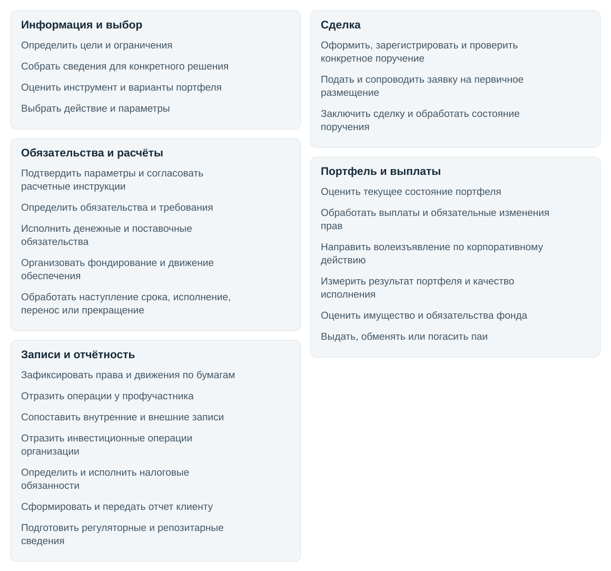
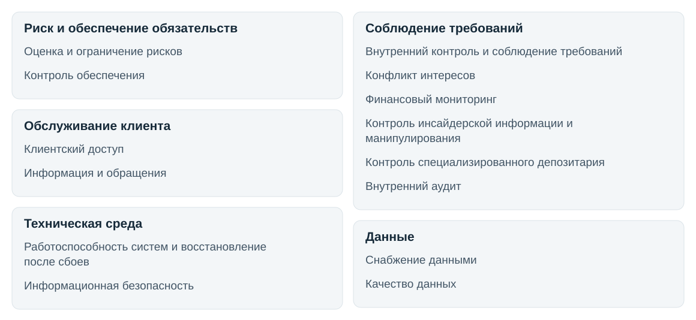

# Процессы инвестиционной деятельности

[Общий обзор](README.md)

[Рынки и инструменты](markets.md)

Все примеры ниже условные. Они иллюстрируют результат работы, а не подтверждают регламент конкретной организации.

## Основная работа

## Информация и выбор

Определить цели и ограничения

**Вход.** Цели, горизонт, обязательства, допустимый риск, договор.

**Результат.** Инвестиционный план или согласованный профиль/мандат.

**Где применяется.** Все области. Формальный профиль применяется по модели услуги, в частности в доверительном управлении.

**Требует уточнения.** Кто задаёт цели, кто подтверждает ограничения и каким результатом фиксируется мандат или план?

**Источники.** [Банк России, стандарт операций управляющего, 16.07.2026](https://www.cbr.ru/Queries/XsltBlock/File/62016/72), [CFA Institute, Portfolio Management: An Overview, 2026](https://www.cfainstitute.org/insights/professional-learning/refresher-readings/2026/portfolio-management-overview).

**Пример.** Инвестор планирует оплатить обучение через два года. Он фиксирует срок, нужную сумму и допустимые потери, чтобы сравнивать вложения с этой целью.

**Роли и ситуации.** [Участник, передача результата и статус разбора](participants.md#role-p01).

Собрать сведения для конкретного решения

**Вход.** Документы инструмента, раскрытия, котировки, позиции.

**Результат.** Набор документов и данных с источниками, датами и статусом пригодности.

**Где применяется.** Все области. Техническое получение данных и их качество обеспечивают «Снабжение данными», «Качество данных».

**Требует уточнения.** Кто выбирает сведения для решения и как устанавливает пригодность набора данных?

**Источники.** [Московская биржа, интерфейс информационно-статистический сервер](https://www.moex.com/a2193), [Московская биржа, фонды](https://www.moex.com/ru/funds).

**Пример.** Аналитик собирает условия выпуска облигации, отчётность эмитента и цены на одну дату, отмечая источник и актуальность каждого документа.

**Роли и ситуации.** [Участник, передача результата и статус разбора](participants.md#role-p02).

Оценить инструмент и варианты портфеля

**Вход.** «Собрать сведения для конкретного решения», условия выплат, ограничения.

**Результат.** Оценка стоимости/доходности/сценариев с предпосылками и рисками.

**Где применяется.** Метод зависит от инструмента.

**Требует уточнения.** Кто выполняет оценку, какие допущения использует и что передаёт принимающему решение?

**Источники.** [CFA Institute, Portfolio Management: An Overview, 2026](https://www.cfainstitute.org/insights/professional-learning/refresher-readings/2026/portfolio-management-overview).

**Пример.** По условиям облигации аналитик рассчитывает денежные потоки и сравнивает результат при разных ставках и предположениях о выплатах.

**Роли и ситуации.** [Участник, передача результата и статус разбора](participants.md#role-p03).

Выбрать действие и параметры

**Вход.** Оценки, цели, позиции, ограничения.

**Результат.** Решение купить, продать, удерживать, хеджировать или отказаться с параметрами.

**Где применяется.** Все области. Рекомендация и решение получателя различаются.

**Требует уточнения.** Кто уполномочен выбрать действие, какие параметры фиксирует и что происходит при удержании позиции или отказе?

**Источники.** [CFA Institute, Portfolio Management: An Overview, 2026](https://www.cfainstitute.org/insights/professional-learning/refresher-readings/2026/portfolio-management-overview), [CFA Institute, Trade Strategy and Execution, 2026](https://www.cfainstitute.org/insights/professional-learning/refresher-readings/2026/trade-strategy-execution).

**Пример.** Управляющий сопоставляет оценку облигации с ограничениями портфеля и принимает решение о покупке с предельной ценой либо отказывается от неё.

**Роли и ситуации.** [Участник, передача результата и статус разбора](participants.md#role-p04).

Передача результатов между процессами

| Кто передаёт | Кому передаёт | Что передаётся | Когда связь применяется |

|---|---|---|---|

| [Определить цели и ограничения](#p01) | [Собрать сведения для конкретного решения](#p02) | Цели и ограничения задают состав нужных сведений | По применимости |

| [Собрать сведения для конкретного решения](#p02) | [Оценить инструмент и варианты портфеля](#p03) | Документы, котировки и позиции для анализа | По применимости |

| [Оценить инструмент и варианты портфеля](#p03) | [Выбрать действие и параметры](#p04) | Оценки и сценарии для выбора действия | По применимости |

| [Выбрать действие и параметры](#p04) | [Оформить, зарегистрировать и проверить конкретное поручение](#p05) | Параметры операции | Выбрано действие, требующее поручения |

## Сделка

Оформить, зарегистрировать и проверить конкретное поручение

**Вход.** Решение, счет, инструмент, объем, цена/условия, полномочия.

**Результат.** Идентифицированное поручение и статус приема/отказа с основанием.

**Где применяется.** Проверки риска и допуска используют «Контроль обеспечения»/«Клиентский доступ». Открытие счета сюда не входит.

**Требует уточнения.** Кто принимает поручение, что проверяет и каким статусом оформляет приём или отказ?

**Источники.** [Банк России, стандарт операций брокера, 18.06.2026](https://www.cbr.ru/Queries/XsltBlock/File/62016/70), [Банк России, 577-П, Вестник31.05.2017, с.24-33](https://www.cbr.ru/queries/xsltblock/file/86297/-1/1881).

**Пример.** Клиент направляет поручение купить десять облигаций с ограничением цены. Брокер проверяет полномочия и допустимость операции и сообщает о приёме или отказе.

**Роли и ситуации.** [Участник, передача результата и статус разбора](participants.md#role-p05).

Подать и сопроводить заявку на первичное размещение

**Вход.** Условия выпуска, доступ через брокера, параметры заявки.

**Результат.** Поданная заявка, сведения о результатах размещения и подтвержденный приход бумаг либо отсутствие удовлетворения.

**Где применяется.** Условная ветка со стороны инвестора. Полная работа эмитента и организатора вне охвата.

**Требует уточнения.** Что делает инвестор через посредника при размещении и как узнаёт, удовлетворена ли заявка?

**Источники.** [Московская биржа, первичные транши облигаций](https://www.moex.com/s2263).

**Пример.** Инвестор подаёт заявку на размещение облигаций. После распределения он получает сведения об удовлетворённом объёме и документы по операции.

**Роли и ситуации.** [Участник, передача результата и статус разбора](participants.md#role-p06).

Заключить сделку и обработать состояние поручения

**Вход.** Поручение, встречные заявки либо согласованные условия.

**Результат.** Одна/несколько сделок с параметрами, исполненная часть и остаток либо отмена.

**Где применяется.** Биржа и внебиржа. Заключение сделки еще не завершает расчеты.

**Требует уточнения.** Кто обрабатывает исполненную часть и остаток поручения, какие записи появляются при нескольких сделках?

**Источники.** [Банк России, стандарт операций брокера, 18.06.2026](https://www.cbr.ru/Queries/XsltBlock/File/62016/70), [Московская биржа, валютные инструменты и режимы](https://www.moex.com/s135), [Московская биржа, TWAP, 22.06.2026](https://www.moex.com/n101230).

**Пример.** Поручение на десять облигаций исполняется двумя сделками по четыре и шесть бумаг. В результате сохраняются обе сделки и статус полного исполнения поручения.

**Роли и ситуации.** [Участник, передача результата и статус разбора](participants.md#role-p07).

Передача результатов между процессами

| Кто передаёт | Кому передаёт | Что передаётся | Когда связь применяется |

|---|---|---|---|

| [Оформить, зарегистрировать и проверить конкретное поручение](#p05) | [Заключить сделку и обработать состояние поручения](#p07) | Принятое поручение | Поручение принято, выбран соответствующий способ исполнения |

| [Оформить, зарегистрировать и проверить конкретное поручение](#p05) | [Подать и сопроводить заявку на первичное размещение](#p06) | Параметры заявки на размещение | Первичное размещение со стороны инвестора |

| [Подать и сопроводить заявку на первичное размещение](#p06) | [Заключить сделку и обработать состояние поручения](#p07) | Подтверждённые параметры заключённой сделки | Если заявка удовлетворена и сделка заключена |

| [Заключить сделку и обработать состояние поручения](#p07) | [Определить обязательства и требования](#p09) | Параметры сделки для определения обязательств | Сделка проходит через соответствующую клиринговую систему |

| [Заключить сделку и обработать состояние поручения](#p07) | [Подтвердить параметры и согласовать расчетные инструкции](#p08) | Параметры сделки и счетов | Отдельное подтверждение и согласование инструкций в соответствующей внебиржевой-модели |

| [Заключить сделку и обработать состояние поручения](#p07) | [Отразить операции у профучастника](#p12) | Документы заключённой сделки | Внутренний учёт профучастника. Запись начинается до завершения расчётов |

## Обязательства и расчёты

Подтвердить параметры и согласовать расчетные инструкции

**Вход.** Данные сделки, счета, даты, валюты и суммы.

**Результат.** Согласованные инструкции либо сообщения о несовпадениях.

**Где применяется.** Явная отдельная операция для соответствующих внебиржевой-процессов. Это не биржевое сопоставление заявок, создающее сделку.

**Требует уточнения.** Кто и как сопоставляет параметры и инструкции, что делает с несовпадением и кому передаёт статус?

**Источники.** [Национальный расчётный депозитарий, электронный мэтчинг](https://www.nsd.ru/services/depozitariy/operatsii-s-tsennymi-bumagami/vnebirzhevye-raschety/elektronnyy-metching/).

**Пример.** В инструкциях сторон внебиржевой сделки указаны разные даты расчётов. Специалисты устанавливают согласованную дату и повторно направляют исправленные инструкции.

**Роли и ситуации.** [Участник, передача результата и статус разбора](participants.md#role-p08).

Определить обязательства и требования

**Вход.** Сделки, позиции, даты, правила клиринга.

**Результат.** Клиринговый отчет с обязательствами/требованиями, по применимости после неттинга.

**Где применяется.** Неттинг означает сведение требований и обязательств. Отдельный центральный контрагент есть не в каждой модели.

**Требует уточнения.** Кто по применимым правилам определяет требования и обязательства, какой документ получает расчётная функция?

**Источники.** [Национальный клиринговый центр, порядок исполнения обязательств](https://www.nationalclearingcentre.ru/catalog/02100201).

**Пример.** По заключённой сделке клиринговая система определяет, сколько денег покупатель должен перечислить и какие бумаги ему причитаются к расчётной дате.

**Роли и ситуации.** [Участник, передача результата и статус разбора](participants.md#role-p09).

Исполнить денежные и поставочные обязательства

**Вход.** Обязательства, инструкции, доступные деньги и активы.

**Результат.** Подтвержденные списания/зачисления либо неисполненное обязательство и статус.

**Где применяется.** Поставка против платежа (поставка против платежа) связывает обмен бумаг и денег. Не каждая операция требует поставки бумаги.

**Требует уточнения.** Кто исполняет денежную или поставочную часть, как подтверждает движение либо неисполненное обязательство?

**Источники.** [Национальный расчётный депозитарий, поставка против платежа](https://www.nsd.ru/services/depozitariy/operatsii-s-tsennymi-bumagami/vnebirzhevye-raschety/kliringovye-uslugi-osushchestvlenie-raschetov-na-usloviyakh-dvp/), [CPMI-IOSCO, международные принципы для инфраструктур финансового рынка, текущий обзор BIS](https://www.bis.org/committees/cpmi/pfmi/overview).

**Пример.** В согласованную дату покупатель перечисляет деньги, а продавец передаёт бумаги. Расчётные документы подтверждают исполнение обеих частей.

**Роли и ситуации.** [Участник, передача результата и статус разбора](participants.md#role-p10).

Организовать фондирование и движение обеспечения

**Вход.** Календарь платежей, маржинальные требования, доступные активы.

**Результат.** План покрытия потребности, распоряжения и подтвержденное размещение/возврат обеспечения.

**Где применяется.** До сделки и в течение жизни позиции. Расчет достаточности относится к «Контроль обеспечения», движение денег/активов к «Исполнить денежные и поставочные обязательства».

**Требует уточнения.** Кто организует покрытие потребности и какие распоряжения готовит для фактического движения?

**Источники.** [Московская биржа, продажа с обязательством обратного выкупа для бизнеса](https://www.moex.com/ru/moneymarkets/repo-business), [Московская биржа, продажа с обязательством обратного выкупа с клиринговые сертификаты участия](https://www.moex.com/ru/markets/money/repoksu/), [Национальный клиринговый центр, порядок исполнения обязательств](https://www.nationalclearingcentre.ru/catalog/02100201).

**Пример.** К расчётной дате ожидается нехватка денег. Специалист определяет источник покрытия и готовит распоряжения на перевод средств или размещение обеспечения.

**Роли и ситуации.** [Участник, передача результата и статус разбора](participants.md#role-p15).

Обработать наступление срока, исполнение, перенос или прекращение

**Вход.** Спецификация/договор, календарь, открытая позиция.

**Результат.** Новые поставочные/денежные обязательства, закрытая либо перенесенная позиция.

**Где применяется.** производные финансовые инструменты, продажа с обязательством обратного выкупа, свопы, депозиты. Фактическое движение исполняется через «Исполнить денежные и поставочные обязательства». Перенос и закрытие различаются.

**Требует уточнения.** Как срок или событие договора приводит к исполнению, переносу либо прекращению и какие движения нужны дальше?

**Источники.** [Московская биржа, фьючерсы](https://www.moex.com/ru/derivatives/futures), [Московская биржа, валютные деривативы СПФИ](https://www.moex.com/ru/spfi/valutnye-derivativy), [Банк России, стандарт операций брокера, 18.06.2026](https://www.cbr.ru/Queries/XsltBlock/File/62016/70), [Московская биржа, единая торговая сессия](https://www.moex.com/ru/derivatives/unified-trading-session).

**Пример.** У фьючерса наступает срок исполнения. По спецификации определяют денежные или поставочные обязательства и передают их на исполнение.

**Роли и ситуации.** [Участник, передача результата и статус разбора](participants.md#role-p16).

Передача результатов между процессами

| Кто передаёт | Кому передаёт | Что передаётся | Когда связь применяется |

|---|---|---|---|

| [Определить обязательства и требования](#p09) | [Исполнить денежные и поставочные обязательства](#p10) | Обязательства и требования для расчётов | По применимости |

| [Подтвердить параметры и согласовать расчетные инструкции](#p08) | [Исполнить денежные и поставочные обязательства](#p10) | Согласованные расчётные инструкции | внебиржевой-модель расчётов. При наличии клиринга используется также «Определить обязательства и требования» |

| [Определить обязательства и требования](#p09) | [Организовать фондирование и движение обеспечения](#p15) | Платёжные и маржинальные требования | Возникла потребность в деньгах или обеспечении |

| [Организовать фондирование и движение обеспечения](#p15) | [Исполнить денежные и поставочные обязательства](#p10) | Распоряжения на движение денег и обеспечения | Нужно исполнить подготовленные распоряжения |

| [Обработать наступление срока, исполнение, перенос или прекращение](#p16) | [Исполнить денежные и поставочные обязательства](#p10) | Новые денежные или поставочные обязательства | Исполнение, перенос или прекращение договора создаёт движения |

| [Исполнить денежные и поставочные обязательства](#p10) | [Отразить операции у профучастника](#p12) | Расчётные подтверждения или статусы для обновления записей | По применимости |

| [Исполнить денежные и поставочные обязательства](#p10) | [Зафиксировать права и движения по бумагам](#p11) | Основания движения по бумагам | Ценные бумаги в соответствующей цепочке учёта прав |

## Портфель и выплаты

Оценить текущее состояние портфеля

**Вход.** Позиции, цены, потоки, целевая структура.

**Результат.** Стоимость и структура на дату, отклонения и основания пересмотра.

**Где применяется.** Все области. Новое решение о ребалансировке относится к «Выбрать действие и параметры».

**Требует уточнения.** Кто оценивает текущее состояние, с чем сравнивает структуру и кому передаёт основания пересмотра?

**Источники.** [CFA Institute, Portfolio Management: An Overview, 2026](https://www.cfainstitute.org/insights/professional-learning/refresher-readings/2026/portfolio-management-overview).

**Пример.** После изменения цен управляющий пересчитывает стоимость и доли активов, чтобы установить отклонение от целевой структуры портфеля.

**Роли и ситуации.** [Участник, передача результата и статус разбора](participants.md#role-p14).

Обработать выплаты и обязательные изменения прав

**Вход.** Условия выпуска, уведомление события, остатки и даты.

**Результат.** Календарь причитающегося, проведенные выплаты/изменения позиции и сообщения об исполнении либо расхождения.

**Где применяется.** Купоны, дивиденды, погашение, денежные и неденежные корпоративные события. Движения отражаются через «Исполнить денежные и поставочные обязательства», «Зафиксировать права и движения по бумагам», «Отразить операции у профучастника», «Сопоставить внутренние и внешние записи».

**Требует уточнения.** Как уведомление о событии превращается в учтённую выплату или изменение прав, как подтверждается фактическое исполнение?

**Источники.** [Национальный расчётный депозитарий, выплаты по ценным бумагам](https://www.nsd.ru/services/depozitariy/obsluzhivanie-aktivov/sodeystvie-realizatsii-prav-po-tsennym-bumagam/vyplata-dokhodov-po-tsennym-bumagam/), [Национальный расчётный депозитарий, информирование по корпоративным действиям](https://www.nsd.ru/services/depozitariy/obsluzhivanie-aktivov/sodeystvie-realizatsii-prav-po-tsennym-bumagam/informirovanie-po-korporativnym-deystviyam/).

**Пример.** По облигации наступает дата купона. Специалист сопоставляет ожидаемую выплату с фактическим поступлением и отражает результат или расхождение.

**Роли и ситуации.** [Участник, передача результата и статус разбора](participants.md#role-p17).

Направить волеизъявление по корпоративному действию

**Вход.** Уведомление, варианты, сроки и решение владельца/управляющего.

**Результат.** Инструкция, подтверждение ее приема/статуса и результат участия.

**Где применяется.** Добровольные действия, голосование, выбор варианта там, где он предусмотрен.

**Требует уточнения.** Кто принимает решение по добровольному действию, кто передаёт инструкцию и отслеживает статус в пределах срока?

**Источники.** [Национальный расчётный депозитарий, добровольные корпоративные действия](https://www.nsd.ru/services/depozitariy/obsluzhivanie-aktivov/sodeystvie-realizatsii-prav-po-tsennym-bumagam/dobrovolnye-korporativnye-deystviya/?tab=tab_1), [Банк России, стандарт операций управляющего, 16.07.2026](https://www.cbr.ru/Queries/XsltBlock/File/62016/72).

**Пример.** Владелец акций решает участвовать в голосовании. Его инструкция передаётся в установленный срок, после чего отслеживается её приём и результат участия.

**Роли и ситуации.** [Участник, передача результата и статус разбора](participants.md#role-p18).

Измерить результат портфеля и качество исполнения

**Вход.** Сделки, цены-ориентиры, потоки, расходы, цели.

**Результат.** Отчет доходности/риска, отклонений и затрат исполнения относительно выбранного ориентира.

**Где применяется.** Оценка полученного результата. Отличается от текущего состояния «Оценить текущее состояние портфеля» и прогнозной оценки «Оценить инструмент и варианты портфеля».

**Требует уточнения.** Кто измеряет полученный результат и качество исполнения, с каким ориентиром сравнивает и кому передаёт вывод?

**Источники.** [CFA Institute, Trade Strategy and Execution, 2026](https://www.cfainstitute.org/insights/professional-learning/refresher-readings/2026/trade-strategy-execution), [CFA Institute, Portfolio Management: An Overview, 2026](https://www.cfainstitute.org/insights/professional-learning/refresher-readings/2026/portfolio-management-overview).

**Пример.** Управляющий сравнивает результат портфеля с выбранным ориентиром, учитывая денежные потоки и расходы, и объясняет обнаруженное отклонение.

**Роли и ситуации.** [Участник, передача результата и статус разбора](participants.md#role-p23).

Оценить имущество и обязательства фонда

**Вход.** Состав активов, оценки, обязательства, число паев.

**Результат.** Стоимость чистых активов (стоимость чистых активов) и расчетная стоимость пая (расчётная стоимость пая) на дату.

**Где применяется.** Для паевой инвестиционный фонд. Расчётная стоимость пая отличается от биржевой цены. Периодичность зависит от применимых правил.

**Требует уточнения.** Кто получает состав имущества, оценки, обязательства и число паёв, как получается стоимость чистых активов и расчётная стоимость пая?

**Источники.** [РСХБ Управление Активами, FAQ о паевой инвестиционный фонд](https://www.rshb-am.ru/raskrytie-informacii/voprosy-i-otvety/paevye-fondy/), [Национальный расчётный депозитарий, сведения о паевой инвестиционный фонд, расчётная стоимость пая и стоимость чистых активов, 08.05.2026](https://www.nsd.ru/ru/news/o-peredache-upravlyayuschimi-kompaniyami-v-nrd-informatsii-o-pif-rsp-i-scha/).

**Пример.** Для установленной даты оценки специалисты фонда определяют стоимость имущества и обязательств и рассчитывают стоимость чистых активов и пая.

**Роли и ситуации.** [Участник, передача результата и статус разбора](participants.md#role-p24).

Выдать, обменять или погасить паи

**Вход.** Заявка, платеж/имущество, правила фонда и согласования.

**Результат.** Выданные/обменянные/погашенные паи, денежная компенсация и уведомление либо отказ.

**Где применяется.** Не вторичная торговля уже существующим паем.

**Требует уточнения.** Кто обрабатывает заявку, связывает её с оплатой или компенсацией и подтверждает выдачу, обмен либо погашение?

**Источники.** [Национальный расчётный депозитарий, Платформа паевой инвестиционный фонд](https://www.nsd.ru/services/depozitariy/kollektivnie-investitsii/kollektivnye-investitsii-v-nrd/), [Национальный расчётный депозитарий, отчет GS036 о расчётная стоимость пая, 24.03.2026](https://www.nsd.ru/ru/news/ob-otchete-gs036-o-raschetnoj-stoimosti-paya-267341/).

**Пример.** Владелец подаёт заявку на погашение паёв. По правилам фонда рассчитывают компенсацию, проводят погашение и оформляют выплату либо мотивированный отказ.

**Роли и ситуации.** [Участник, передача результата и статус разбора](participants.md#role-p25).

Передача результатов между процессами

| Кто передаёт | Кому передаёт | Что передаётся | Когда связь применяется |

|---|---|---|---|

| [Оценить текущее состояние портфеля](#p14) | [Измерить результат портфеля и качество исполнения](#p23) | Позиции и потоки как часть данных для оценки результата | Дополнительно нужны сделки, расходы, цели и ориентиры |

| [Измерить результат портфеля и качество исполнения](#p23) | [Выбрать действие и параметры](#p04) | Отклонения и результат для пересмотра решения | Пересмотр при необходимости. «Выбрать действие и параметры» может означать удержание позиции или отказ от операции |

| [Оценить текущее состояние портфеля](#p14) | [Обработать выплаты и обязательные изменения прав](#p17) | Позиции на дату для обработки событий | Наступило событие по условиям актива или получено уведомление |

| [Оценить текущее состояние портфеля](#p14) | [Направить волеизъявление по корпоративному действию](#p18) | Позиция и сведения для реализации прав | Добровольное корпоративное действие, уведомление и решение владельца |

| [Оценить текущее состояние портфеля](#p14) | [Обработать наступление срока, исполнение, перенос или прекращение](#p16) | Состояние открытой позиции | Срок или событие по спецификации производные финансовые инструменты, продажа с обязательством обратного выкупа, свопа либо депозита |

| [Обработать выплаты и обязательные изменения прав](#p17) | [Исполнить денежные и поставочные обязательства](#p10) | Параметры причитающихся денежных или поставочных движений | Денежное или неденежное событие. Обработка «Обработать выплаты и обязательные изменения прав» также использует итог движения |

| [Оценить имущество и обязательства фонда](#p24) | [Выдать, обменять или погасить паи](#p25) | Расчётная стоимость пая для применимой операции | паевой инвестиционный фонд, заявка и правила фонда. Оценка сама по себе не запускает выдачу или погашение |

| [Выдать, обменять или погасить паи](#p25) | [Исполнить денежные и поставочные обязательства](#p10) | Параметры оплаты или компенсации | Если операция с паями требует движения. «Выдать, обменять или погасить паи» использует и его подтверждение |

| [Оценить имущество и обязательства фонда](#p24) | [Подготовить регуляторные и репозитарные сведения](#p22) | стоимость чистых активов и расчётная стоимость пая для применимого сообщения | Требования к сведениям по фонду |

## Записи и отчётность

Зафиксировать права и движения по бумагам

**Вход.** Основания операции и расчетные документы.

**Результат.** Записи о зачислении, списании, переводе/обременении и выписка/отчет.

**Где применяется.** Для бумаг в соответствующей учетной цепочке. Сам фьючерс не превращается в акцию на счете депо.

**Требует уточнения.** Кто и на основании каких документов меняет запись о правах, какую выписку получает следующий участник?

**Источники.** [Банк России, стандарт депозитарных операций](https://www.cbr.ru/Queries/XsltBlock/File/62016/3).

**Пример.** После поставки облигаций депозитарий отражает их зачисление на счёт владельца и формирует подтверждение записи о правах.

**Роли и ситуации.** [Участник, передача результата и статус разбора](participants.md#role-p11).

Отразить операции у профучастника

**Вход.** Документы поручений, сделок, движения активов.

**Результат.** Связанные записи о клиенте, сделке, активах, деньгах и обязательствах.

**Где применяется.** Внутренний учет брокера/дилера/управляющего. Не равен бухгалтерскому.

**Требует уточнения.** Кто связывает поручение, сделку, деньги и активы во внутренних записях, что обновляет после расчётов?

**Источники.** [Банк России, 577-П, Вестник31.05.2017, с.24-33](https://www.cbr.ru/queries/xsltblock/file/86297/-1/1881), [Банк России, 5531-У, Вестник30.09.2020, с.69-71](https://cbr.ru/Queries/XsltBlock/File/105012/-1/2212).

**Пример.** Брокер связывает клиентское поручение с двумя сделками и ожидаемыми расчётами. После получения подтверждений он обновляет записи о деньгах и бумагах.

**Роли и ситуации.** [Участник, передача результата и статус разбора](participants.md#role-p12).

Сопоставить внутренние и внешние записи

**Вход.** Регистры, выписки, отчеты банка, депозитария, клиринга.

**Результат.** Подтвержденные совпадения, перечень расхождений, исправления с основаниями.

**Где применяется.** Сверка не заменяет исходную запись операции.

**Требует уточнения.** Какие внутренние и внешние записи сравниваются, кто разбирает расхождения и обосновывает исправления?

**Источники.** [Банк России, 577-П, Вестник31.05.2017, с.24-33](https://www.cbr.ru/queries/xsltblock/file/86297/-1/1881), [Банк России, 5531-У, Вестник30.09.2020, с.69-71](https://cbr.ru/Queries/XsltBlock/File/105012/-1/2212).

**Пример.** Внутренний учёт показывает десять облигаций, а внешняя выписка восемь. Специалист устанавливает причину расхождения и документирует исправление либо незавершённую операцию.

**Роли и ситуации.** [Участник, передача результата и статус разбора](participants.md#role-p13).

Отразить инвестиционные операции организации

**Вход.** Первичные документы, политика учета, оценки и расходы.

**Результат.** Бухгалтерские записи, балансовые показатели и финансовый результат.

**Где применяется.** Для организаций по применимой системе учета. Не универсальная схема счетов.

**Требует уточнения.** Кто отражает операцию по применимой учётной политике и как связаны первичный документ, оценка и проводка?

**Источники.** [Банк России, бухгалтерский учет некредитные финансовые организации, разъяснения](https://www.cbr.ru/explan/acts_bnko/).

**Пример.** Бухгалтер организации получает документы по покупке облигаций и отражает операцию по применимой учётной политике.

**Роли и ситуации.** [Участник, передача результата и статус разбора](participants.md#role-p19).

Определить и исполнить налоговые обязанности

**Вход.** Доходы, подтвержденные расходы, статусы, удержания.

**Результат.** База и расчет налога, удержание/перечисление либо сведения для декларации.

**Где применяется.** Исполнитель зависит от инструмента и статуса. Национальный расчётный депозитарий и брокер не универсальные налоговые агенты всех операций.

**Требует уточнения.** Кто в выбранном случае определяет налоговые обязанности, какие статусы и расходы нужны помимо операций?

**Источники.** [Национальный расчётный депозитарий, налоговое администрирование российских бумаг](https://www.nsd.ru/services/depozitariy/obsluzhivanie-aktivov/nalogovoe-administrirovanie/rossiyskie-tcennye-bumagi/), [Национальный расчётный депозитарий, обслуживание паев с01.03.2026](https://www.nsd.ru/faq/156-fz/).

**Пример.** Налоговый специалист сопоставляет доход от продажи бумаг с подтверждёнными расходами и статусом владельца, после чего определяет обязанности по налогу.

**Роли и ситуации.** [Участник, передача результата и статус разбора](participants.md#role-p20).

Сформировать и передать отчет клиенту

**Вход.** Записи операций, активов, обязательств и сверок.

**Результат.** Брокерский/управленческий отчет или выписка за период.

**Где применяется.** Содержание зависит от услуги, а получатель является конкретным клиентом.

**Требует уточнения.** Кто собирает отчёт конкретному клиенту, какие данные использует и как обрабатывает вопрос по отчёту?

**Источники.** [Банк России, 577-П, Вестник31.05.2017, с.24-33](https://www.cbr.ru/queries/xsltblock/file/86297/-1/1881), [Банк России, стандарт депозитарных операций](https://www.cbr.ru/Queries/XsltBlock/File/62016/3).

**Пример.** По итогам месяца сотрудник формирует клиентский отчёт со сделками, остатками и движением денег и передаёт его клиенту.

**Роли и ситуации.** [Участник, передача результата и статус разбора](participants.md#role-p21).

Подготовить регуляторные и репозитарные сведения

**Вход.** Учетные данные, сделки, применимые требования.

**Результат.** Отчет/сообщение и статус приема или список ошибок.

**Где применяется.** Получатели и форматы различаются. Репозитарная регистрация применима к установленным договорам и участникам.

**Требует уточнения.** Кто подготавливает сведения для конкретного внешнего получателя и разбирает отказ в приёме или ошибки?

**Источники.** [Национальный расчётный депозитарий, регистрация внебиржевых сделок](https://www.nsd.ru/services/repozitariy/repozitariy-nrd/), [Банк России, отчетность спецдепозитариев](https://www.cbr.ru/projects_xbrl/explan/otchetnost-specializirovannykh-depozitariev/).

**Пример.** Специалист готовит сообщение по договору, для которого требуется репозитарная регистрация, и проверяет статус приёма или причины отклонения.

**Роли и ситуации.** [Участник, передача результата и статус разбора](participants.md#role-p22).

Передача результатов между процессами

| Кто передаёт | Кому передаёт | Что передаётся | Когда связь применяется |

|---|---|---|---|

| [Отразить операции у профучастника](#p12) | [Сопоставить внутренние и внешние записи](#p13) | Внутренние регистры для сопоставления | По применимости |

| [Зафиксировать права и движения по бумагам](#p11) | [Сопоставить внутренние и внешние записи](#p13) | Выписки и сведения о правах для сопоставления | По применимости |

| [Сопоставить внутренние и внешние записи](#p13) | [Отразить инвестиционные операции организации](#p19) | Сверенные данные и основания исправлений | Организация, применимая система бухгалтерского учёта. Сверка не является единственным основанием записи |

| [Сопоставить внутренние и внешние записи](#p13) | [Определить и исполнить налоговые обязанности](#p20) | Подтверждённые доходы, расходы и операции | Применимые налоговые обязанности. Дополнительно нужны статусы и иные налоговые данные |

| [Сопоставить внутренние и внешние записи](#p13) | [Сформировать и передать отчет клиенту](#p21) | Записи и результаты сверок для клиентского отчёта | По применимости |

| [Сопоставить внутренние и внешние записи](#p13) | [Подготовить регуляторные и репозитарные сведения](#p22) | Учётные сведения для применимой внешней отчётности | По применимости |

| [Сопоставить внутренние и внешние записи](#p13) | [Оценить текущее состояние портфеля](#p14) | Сверенные позиции и потоки | Для оценки также нужны цены и целевая структура |

| [Сопоставить внутренние и внешние записи](#p13) | [Оценить имущество и обязательства фонда](#p24) | Сверенные данные об активах и обязательствах фонда | паевой инвестиционный фонд. Также нужны оценки и число паёв |

## Обеспечение работы

## Риск и обеспечение обязательств

Оценка и ограничение рисков

**Вход.** Позиции, цены, обязательства, контрагенты, сценарии.

**Результат.** Оценки рыночного/кредитного/ликвидного и иных существенных рисков, ограничения и нарушения.

**Где применяется.** «Определить цели и ограничения», «Собрать сведения для конкретного решения», «Оценить инструмент и варианты портфеля», «Выбрать действие и параметры», «Определить обязательства и требования», «Исполнить денежные и поставочные обязательства», «Зафиксировать права и движения по бумагам», «Отразить операции у профучастника», «Сопоставить внутренние и внешние записи», «Оценить текущее состояние портфеля», «Организовать фондирование и движение обеспечения», «Обработать наступление срока, исполнение, перенос или прекращение», «Обработать выплаты и обязательные изменения прав», «Направить волеизъявление по корпоративному действию». Набор методов зависит от участника.

**Требует уточнения.** Кто получает позиции и цены, выдаёт оценки и ограничения, кому сообщает выявленное нарушение?

**Назначение.** Соответствие принятого риска целям и возможностям.

**Источники.** [Банк России, стандарт операций управляющего, 16.07.2026](https://www.cbr.ru/Queries/XsltBlock/File/62016/72), [CPMI-IOSCO, международные принципы для инфраструктур финансового рынка, текущий обзор BIS](https://www.bis.org/committees/cpmi/pfmi/overview).

**Пример.** После падения цены одной бумаги специалист пересчитывает риск портфеля и сообщает управляющему о нарушенном ограничении.

**Роли и ситуации.** [Участник, передача результата и статус разбора](participants.md#role-s01).

Контроль обеспечения

**Вход.** Позиции, заявки, параметры риска и допустимое обеспечение.

**Результат.** Доступный лимит, размер дефицита/маржинального требования и статус устранения.

**Где применяется.** «Оформить, зарегистрировать и проверить конкретное поручение», «Определить обязательства и требования», «Организовать фондирование и движение обеспечения», «Обработать наступление срока, исполнение, перенос или прекращение». Требование Национальный клиринговый центр адресовано участнику клиринга, клиентские условия брокера отдельны.

**Требует уточнения.** Кто рассчитывает достаточность, кому адресует дефицит и как различаются отношения клиринга и брокера с клиентом?

**Назначение.** Достаточность покрытия обязательств.

**Источники.** [Национальный клиринговый центр, маржинальные требования](https://www.nationalclearingcentre.ru/catalog/02811).

**Пример.** Изменение стоимости позиции создаёт дефицит обеспечения. Контроль определяет его величину и направляет требование по применимым условиям.

**Роли и ситуации.** [Участник, передача результата и статус разбора](participants.md#role-s02).

## Соблюдение требований

Внутренний контроль и соблюдение требований

**Вход.** Требования, операции, документы, обращения.

**Результат.** Запись регуляторного события, отчет с мерами и статус исправления.

**Где применяется.** Все этапы.

**Требует уточнения.** Кто выявляет регуляторное событие, определяет меры и проверяет статус исправления?

**Назначение.** Соблюдение требований и устранение нарушений.

**Источники.** [Банк России, 5683-У, Вестник25.02.2021, с.45-53](https://www.cbr.ru/Queries/XsltBlock/File/117713/0/2251).

**Пример.** При проверке операции выявлено несоответствие внутреннему требованию. Сотрудник контроля фиксирует нарушение, меры и срок проверки исправления.

**Роли и ситуации.** [Участник, передача результата и статус разбора](participants.md#role-s03).

Конфликт интересов

**Вход.** Интересы клиента, компании и работников, операции.

**Результат.** Зафиксированный конфликт и решение по предотвращению/урегулированию.

**Где применяется.** Решение, распределение и исполнение, сервис. Национальный клиринговый центр подтверждает собственную практику, формат выхода аналитический.

**Требует уточнения.** Кто обнаруживает противоречие интересов, кто принимает решение и что меняется в конкретной работе?

**Назначение.** Корректное разрешение противоречащих интересов.

**Источники.** [Национальный клиринговый центр, конфликт интересов](https://www.nationalclearingcentre.ru/catalog/011504).

**Пример.** При распределении сделок обнаружено возможное преимущество одного клиента перед другим. Ответственный специалист документирует конфликт и способ его урегулирования.

**Роли и ситуации.** [Участник, передача результата и статус разбора](participants.md#role-s04).

Финансовый мониторинг

**Вход.** Документы клиента/представителей/бенефициаров, операции.

**Результат.** Актуализированные сведения и документированное решение/сообщение в предусмотренных случаях.

**Где применяется.** Подключение и дальнейшие операции. Пример регламента брокерская компания «БКС», без обобщения его условий на всех.

**Требует уточнения.** Какие сведения и операции запускают проверку, кто документирует применимое решение или сообщение?

**Назначение.** Идентификацию и применимый контроль операций.

**Источники.** [брокерская компания «БКС», регламент с01.09.2026](https://shared.storage.bcs.ru/static/broker/f/reg/reglament/reglament-260901.pdf).

**Пример.** При обновлении сведений клиента выявлен недостающий документ. Сотрудник запрашивает его и фиксирует решение в рамках применимых требований финансового мониторинга.

**Роли и ситуации.** [Участник, передача результата и статус разбора](participants.md#role-s05).

Контроль инсайдерской информации и манипулирования

**Вход.** Информация ограниченного доступа, сведения об инсайдерах и операциях.

**Результат.** Права доступа, материалы проверки и решение о реагировании.

**Где применяется.** «Собрать сведения для конкретного решения», «Оценить инструмент и варианты портфеля», «Выбрать действие и параметры», «Оформить, зарегистрировать и проверить конкретное поручение», «Подать и сопроводить заявку на первичное размещение», «Заключить сделку и обработать состояние поручения». Официально подтверждена система Национальный клиринговый центр.

**Требует уточнения.** Кто управляет доступом к соответствующей информации, разбирает торговое событие и принимает меры?

**Назначение.** Предотвращение неправомерного использования информации и торговых нарушений.

**Источники.** [Национальный клиринговый центр, инсайд и манипулирование](https://www.nationalclearingcentre.ru/catalog/011502).

**Пример.** В операции обнаружены признаки возможного использования закрытой информации. Специалист сохраняет материалы и проводит проверку по установленному порядку.

**Роли и ситуации.** [Участник, передача результата и статус разбора](participants.md#role-s06).

Контроль специализированного депозитария

**Вход.** Распоряжение управляющая компания, имущество и документы.

**Результат.** Акцепт/выявленное несоответствие, согласованные данные для учета и отчетности.

**Где применяется.** «Заключить сделку и обработать состояние поручения», «Исполнить денежные и поставочные обязательства», «Оценить имущество и обязательства фонда», «Выдать, обменять или погасить паи». Самостоятельная функция относительно хранения и брокерского контроля.

**Требует уточнения.** Что именно проверяет спецдепозитарий, какой акцепт или несоответствие получает управляющая компания и на какой процесс это влияет?

**Назначение.** Контроль распоряжения имуществом паевой инвестиционный фонд.

**Источники.** [Банк России, отчетность спецдепозитариев](https://www.cbr.ru/projects_xbrl/explan/otchetnost-specializirovannykh-depozitariev/), [Национальный расчётный депозитарий, банковские сервисы для управляющая компания](https://www.nsd.ru/services/depozitariy/kollektivnie-investitsii/servisy-dlya-upravlyayushchikh-kompaniy/).

**Пример.** Управляющая компания направляет распоряжение по имуществу фонда. Специализированный депозитарий проверяет его и сообщает о согласовании либо несоответствии.

**Роли и ситуации.** [Участник, передача результата и статус разбора](participants.md#role-s07).

Внутренний аудит

**Вход.** Процессы, документы и прежние проверки.

**Результат.** Результаты проверки, недостатки, рекомендации и статус выполнения.

**Где применяется.** Периодически по применимым условиям, а не замена ежедневного контроля.

**Требует уточнения.** Как выбирается предмет периодической проверки и кто использует выводы и контролирует рекомендации?

**Назначение.** Независимую оценку контроля и управления рисками.

**Источники.** [Банк России, 5683-У, Вестник25.02.2021, с.45-53](https://www.cbr.ru/Queries/XsltBlock/File/117713/0/2251).

**Пример.** Аудитор выбирает завершённые операции и оценивает, работали ли предусмотренные проверки, после чего оформляет недостатки и рекомендации.

**Роли и ситуации.** [Участник, передача результата и статус разбора](participants.md#role-s08).

## Обслуживание клиента

Клиентский доступ

**Вход.** Документы, договор, статус, требуемое тестирование.

**Результат.** Счет, условия обслуживания и права доступа к инструментам.

**Где применяется.** До «Оформить, зарегистрировать и проверить конкретное поручение» и при изменениях. Идентификация, квалификация и тестирование являются разными проверками.

**Требует уточнения.** Какие счёт, условия и права доступа должны быть оформлены до приёма поручения и кто это подтверждает?

**Назначение.** Оформленное обслуживание и допустимые операции.

**Источники.** [брокерская компания «БКС», регламент с01.09.2026](https://shared.storage.bcs.ru/static/broker/f/reg/reglament/reglament-260901.pdf), [Банк России, защита клиентов брокеров, 2025](https://www.cbr.ru/Queries/XsltBlock/File/62016/63).

**Пример.** Клиент оформляет обслуживание и проходит необходимые для выбранного инструмента проверки. В результате ему предоставляют допустимый доступ либо объясняют ограничение.

**Роли и ситуации.** [Участник, передача результата и статус разбора](participants.md#role-s09).

Информация и обращения

**Вход.** Условия услуги, операции, документы, запрос/жалоба.

**Результат.** Предоставленная информация, зарегистрированное обращение и мотивированный ответ/действия.

**Где применяется.** Подключение, поручение, сопровождение и отчетность.

**Требует уточнения.** Кто получает запрос или жалобу, какие документы собирает и каким ответом или действием завершает обращение?

**Назначение.** Понимание условий и разбор клиентских ситуаций.

**Источники.** [Банк России, защита клиентов брокеров, 2025](https://www.cbr.ru/Queries/XsltBlock/File/62016/63).

**Пример.** Клиент спрашивает о непоступившей выплате. Специалист сопоставляет условия события и документы по счёту и готовит ответ с необходимыми действиями.

**Роли и ситуации.** [Участник, передача результата и статус разбора](participants.md#role-s10).

## Данные

Снабжение данными

**Вход.** Источники, метаданные, справочники, договорные условия.

**Результат.** Доступный набор с режимом обновления и условиями использования.

**Где применяется.** «Собрать сведения для конкретного решения», «Оценить инструмент и варианты портфеля», «Заключить сделку и обработать состояние поручения», «Оценить текущее состояние портфеля», контроль. информационно-статистический сервер подтверждает способы предоставления, а не безошибочность данных.

**Требует уточнения.** Как рыночные и справочные данные становятся доступными для «Собрать сведения для конкретного решения» и какие условия обновления передаются с набором?

**Назначение.** Доступность нужных рыночных и справочных сведений.

**Источники.** [Московская биржа, интерфейс информационно-статистический сервер](https://www.moex.com/a2193).

**Пример.** Система получает котировки и справочник инструментов с установленной частотой и передаёт пользователям сведения об источнике и режиме обновления.

**Роли и ситуации.** [Участник, передача результата и статус разбора](participants.md#role-s11).

Качество данных

**Вход.** Данные, правила качества, проверки и инциденты.

**Результат.** Отчет проверок, реестр проблем, причины, план исправлений и статус.

**Где применяется.** Все этапы. Предложенная Банк России модель рекомендательная.

**Требует уточнения.** Кто проверяет качество, фиксирует причину проблемы и подтверждает исправление данных?

**Назначение.** Пригодность и прослеживаемое исправление данных.

**Источники.** [Банк России, управление рисками данных, 2026](https://www.cbr.ru/Content/Document/File/189607/recommendations_10042026.pdf).

**Пример.** В наборе цен обнаружен пропуск. Специалист фиксирует дефект, устанавливает причину и проверяет исправленный набор перед использованием.

**Роли и ситуации.** [Участник, передача результата и статус разбора](participants.md#role-s12).

## Техническая среда

Работоспособность систем и восстановление после сбоев

**Вход.** Системные события, зависимости, сбои и испытания.

**Результат.** Зарегистрированный инцидент, восстановленный процесс, причины и меры, результаты испытаний.

**Где применяется.** Все автоматизированные этапы. Модель зависит от типа участника.

**Требует уточнения.** Кто получает сообщение о сбое, восстанавливает процесс и фиксирует причину и меры?

**Назначение.** Непрерывность и восстановление процессов.

**Источники.** [Банк России, рекомендации по операционному риску](https://www.cbr.ru/Crosscut/LawActs/File/9909), [CPMI-IOSCO, международные принципы для инфраструктур финансового рынка, текущий обзор BIS](https://www.bis.org/committees/cpmi/pfmi/overview).

**Пример.** Поток операций перестаёт поступать из внешней системы. Инженер регистрирует сбой, восстанавливает обмен и проверяет полноту полученных записей.

**Роли и ситуации.** [Участник, передача результата и статус разбора](participants.md#role-s13).

Информационная безопасность

**Вход.** Угрозы, уязвимости, события, требования защиты.

**Результат.** Меры защиты, оценка риска и материалы реагирования.

**Где применяется.** Все этапы. Рекомендации Банк России имеют определенный круг адресатов.

**Требует уточнения.** Кто обрабатывает угрозу или нарушение доступа, кому передаёт меры защиты и результат реагирования?

**Назначение.** Контроль доступа и угроз информации.

**Источники.** [Банк России, рекомендации по операционному риску](https://www.cbr.ru/Crosscut/LawActs/File/9909).

**Пример.** При попытке доступа к сведениям вне полномочий сотрудника система ограничивает доступ, а ответственный специалист проверяет событие и меры защиты.

**Роли и ситуации.** [Участник, передача результата и статус разбора](participants.md#role-s14).

Термины процессов

| Термин | Простое объяснение |
|---|---|
| **Поручение** | Указание клиента брокеру совершить определённые операции |
| **Торговая заявка** | Предложение условий сделки в выбранном механизме торгов. Одно поручение может исполняться через несколько заявок и сделок |
| **Сделка** | Согласованные условия, из которых возникают права и обязательства |
| **Клиринг** | Определение обязательств и требований по правилам соответствующей системы, по применимости с их взаимным зачётом |
| **Расчёты** | Исполнение обязательств, включая движение денег и поставляемых активов |
| **Учёт прав** | Записи о принадлежности ценных бумаг и ограничениях распоряжения ими |
| **Сверка** | Сопоставление записей и документов для подтверждения совпадений и обнаружения расхождений |
| **Обеспечение** | Деньги или иные допустимые активы, предоставленные для покрытия обязательств |

## Основания и границы

Актуальность документов и ограничения исследования

Ниже приведены сведения, проверенные автором исходного исследования 8 ноября 2026 года. Они не заменяют повторную проверку правил перед применением к конкретной организации.

- Стандарты операций брокера и управляющего применяются с 1 сентября 2026 года. Старую редакцию брокерского стандарта автор не использовал как действующую.
- В описании срочного рынка учтены изменения с 23 марта 2026 года. Переоценка позиции отделена от фактических расчётов, точные часы и тарифы в карту не включены.
- В порядке обслуживания выплат по паям с 1 марта 2026 года управляющая компания сохраняет функцию налогового агента, а Национальный расчётный депозитарий передаёт выплаты по полученному распределению.
- Документы о внутреннем учёте и контроле использованы для структуры процессов. Все действующие поправки не сведены в единый регламент, обязательная периодичность проверок и схема счетов не установлены.
- Международные принципы для инфраструктур финансового рынка 2012 года использованы как архитектурная основа. Они не задают одинаковый регламент всем инвесторам.
- Материалы биржи, депозитария, клирингового центра и отдельных финансовых компаний подтверждают соответствующие операции и практики. Они не доказывают одинаковую организацию работы у всех участников.
- Страницы, недоступные автору во время исследования, не использованы как прочитанные доказательства. Указанная им недоступность Wiki относится к тому моменту, сейчас Wiki доступна.
- Интервью, проверка спроса, конкурентов, готовности платить и эффективности моделей искусственного интеллекта не проводились.

Основания перечислены в [исходном отчёте](archive/original-2026-11-08/report.md).

Редакция основана на [исследовании от 8 ноября 2026 года](archive/original-2026-11-08/report.md). Полный [список источников](archive/original-2026-11-08/sources.md) и авторские материалы сохранены в архиве без изменений. Названия работ, группировка и связи являются аналитической моделью, которую нужно уточнять для выбранного участника и рынка.

Сведения о полноте относятся к выбранному обзорному уровню, а не ко всем операциям каждого рынка.

Вопросы в карточках перенесены из программы следующего исследования. Они обозначают неизвестное, а не полученные ответы. Частота задач, затраты времени, цена ошибки и спрос пока не установлены.

Для [разбора ролей](https://github.com/vafaevelshodbek-png/invest-premarket/issues/31) можно выбирать конкретные ситуации, подробное изучение всей карты не является условием продолжения.
