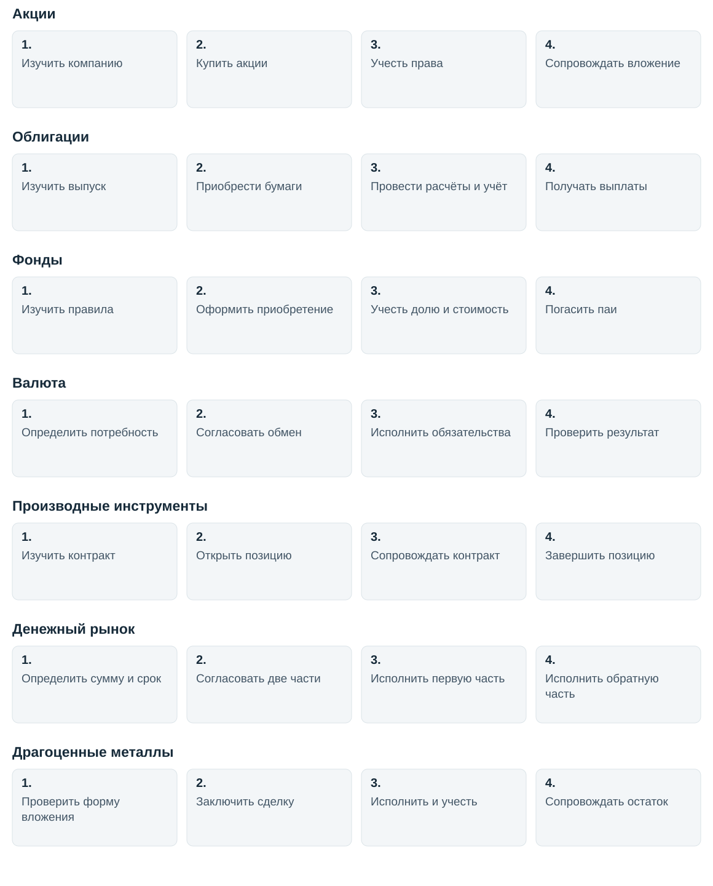

# Рынки и инструменты

[Общий обзор](README.md)

Как различать признаки вложения

| Измерение | Что описывает | Примеры |
|---|---|---|
| Область рынка | Навигационный контекст деятельности | Долговые бумаги, валютные операции, денежный рынок |
| Инструмент и права | Юридическая или договорная форма позиции | Акция, облигация, пай, депозитное требование, производный контракт |
| Экономические вложения | Что находится внутри фонда | Облигации, акции, продажа с обязательством обратного выкупа, металлы |
| Базовый актив производные финансовые инструменты | От чего зависит производный контракт | Валютный курс, акция, индекс, процентная ставка |
| Цель, горизонт и управление | Зачем и как принимается решение | Вложение, хеджирование, арбитраж, активное/пассивное управление |
| Организация сделки | Где и как согласуются условия | Биржа/внебиржа, встречные заявки/адресная сделка |
| Фаза обращения | Возникновение бумаги или ее последующий оборот | Первичное размещение/вторичное обращение, отдельно выдача/погашение паев |
| Клиринг и расчеты | Как определяются и исполняются обязательства | центральный контрагент/двусторонняя модель, поставка/денежный расчет, срок T+N |
| Этап и обеспечивающая функция | Какая работа выполняется | Анализ, заключение, учет, риск, клиентский сервис |

Подходы к инвестициям и исполнению

| Признак подхода | Значения | Что меняется в процессах |
|---|---|---|
| Горизонт | Долгосрочное вложение, среднесрочные и внутридневные операции | Частота пересмотра и требования к своевременности информации |
| Способ управления | Активное, пассивное/индексное | Основание решения и правило ребалансировки |
| Цель операции | Инвестирование, хеджирование, арбитраж, управление ликвидностью, предоставление ликвидности | Критерий результата: экспозиция, покрытие риска, согласованные сделки, деньги на нужную дату |
| Уровень решения | Позиция, портфель, фонд | Набор совместно учитываемых ограничений и обязательств |
| Метод исполнения | Ручное, алгоритмическое | Разбиение поручения, управление остатком и оценка исполнения |

Особенности рынков и инструментов

| Область | Инструменты и подгруппы | Экономический смысл и права | Границы и пересечения | Источники |
|---|---|---|---|---|
| Акции | Обыкновенные и привилегированные | Участие в капитале. Права и выплаты зависят от типа бумаги и корпоративных решений | Расписка и производный контракт на акцию не тождественны самой акции. Первичное размещение отдельно от вторичного обращения | [Источник](https://www.moex.com/ru/stocks) |
| Облигации | Государственные, муниципальные, корпоративные, банковские. Разные сроки, валюты и условия потоков | Долговое требование к эмитенту по условиям выпуска | Валютная облигация сохраняет долговую природу. Не у всех выпусков фиксированный купон или одинаковая схема возврата | [Источник](https://www.moex.com/ru/bonds) |
| Фонды | Паи открытых, интервальных, закрытых и биржевых паевой инвестиционный фонд. Для международного сопоставления также биржевые инвестиционные фонды и другие коллективные формы | Пай выражает участие в имуществе фонда. Управление имуществом осуществляет управляющая компания | Класс вложений фонда отдельный признак. Рыночная цена пая и его расчетная стоимость различаются. Вторичная продажа отличается от погашения | [Источник](https://www.moex.com/ru/funds) [Источник](https://www.rshb-am.ru/raskrytie-informacii/voprosy-i-otvety/paevye-fondy/) [Источник](https://www.moex.com/ru/funds/for-business) |
| Валюта | Спот, обмен с разными датами расчетов, свопы соответствующих режимов | Конверсия денег и изменение валютных остатков/обязательств | Различаются объект обмена, валюта номинала, цены и платежа. валютный своп связан также с производные финансовые инструменты и ликвидностью | [Источник](https://www.moex.com/s135) [Источник](https://www.moex.com/ru/spfi/valutnye-derivativy) |
| производные финансовые инструменты | Фьючерсы, опционы, форварды, процентные и валютные свопы | Договорные права и обязательства, зависящие от базового актива/показателя. У опциона различаются право покупателя и обязательство продавца | Биржевые и внебиржевые, стандартные и индивидуальные, расчетные и поставочные контракты. Наличие центральный контрагент выделяется отдельно | [Источник](https://www.moex.com/ru/derivatives/futures) [Источник](https://www.moex.com/ru/derivatives/options) [Источник](https://www.moex.com/ru/spfi/valutnye-derivativy) |
| Денежный рынок | продажа с обязательством обратного выкупа с конкретными бумагами или клиринговый сертификат участия, междилерское продажа с обязательством обратного выкупа, депозиты и кредиты соответствующих сегментов | Привлечение и размещение ликвидности. В продажа с обязательством обратного выкупа связаны первоначальная и обратная купля-продажа | Это функциональная область. Облигация в продажа с обязательством обратного выкупа остается отдельной бумагой. клиринговый сертификат участия и активы имущественного пула требуют различения. Срок хранится отдельным признаком | [Источник](https://www.moex.com/ru/moneymarkets/repo-business) [Источник](https://www.moex.com/msn/float) [Источник](https://www.moex.com/ru/markets/money/repoksu/) |
| Металлы, дополнение | Прямые биржевые операции. Косвенно паи и производные финансовые инструменты на металлы | Прямой металл либо участие в фонде/контрактные права | Физический слиток, банковский металлический счет, биржевая позиция, пай и фьючерс не взаимозаменяемы по правам и инфраструктуре | [Источник](https://www.moex.com/preciousmetals) |

Примеры пересечений

| Ситуация | Одновременная классификация | Процесс и выход |
|---|---|---|
| Покупка фонда облигаций на вторичном рынке | Инструмент инвестора: пай. Вложения фонда: облигации. Способ: биржа. Фаза: вторичная | [Оформление поручения](details.md#p05), [исполнение](details.md#p07), [клиринг](details.md#p09) и [расчёты](details.md#p10) в применимой биржевой модели, затем [учёт прав](details.md#p11), [внутренний учёт](details.md#p12) и [сверка](details.md#p13). Результат инвестора: позиция в паях. Первичное размещение, выдача и погашение паёв имеют отдельные ветки. Управление облигациями внутри фонда является отдельной работой УК |
| Фонд денежного рынка | Форма: паевой инвестиционный фонд. Вложения: инструменты денежного рынка согласно правилам. Цель инвестора задается отдельно | Сделка с паем не означает прямой депозит или продажа с обязательством обратного выкупа пайщика. Оценить имущество и обязательства фонда , затем  стоимость чистых активов/расчётная стоимость пая. [Источник](https://www.moex.com/ru/moneyfunds) |
| Облигация в иностранной валюте | Вид: долговая бумага. Отдельные поля: валюта номинала, котировки и платежа | Оценить инструмент и варианты портфеля , затем  оценка кредитного риска и потоков. Валютный признак не заменяет долговую природу |
| Валютный фьючерс | Вид: производные финансовые инструменты. Подвид: фьючерс. Базовый актив: валютный курс/пара по спецификации. Способ: биржа | Обработать наступление срока, исполнение, перенос или прекращение , затем  исполнение расчетом или поставочное обязательство. Покупка контракта сама по себе не покупка валютного остатка |
| продажа с обязательством обратного выкупа с облигацией | Операция: продажа с обязательством обратного выкупа. Объект: облигация. Функция: ликвидность. Две связанные части | Организовать фондирование и движение обеспечения, Обработать наступление срока, исполнение, перенос или прекращение и Исполнить денежные и поставочные обязательства , затем  финансирование, обеспечение и исполнение возврата. Бумага и договор имеют разные идентификаторы |
| Валютный своп | Операция: валютный своп. Экспозиция: две валюты. Цель может быть ликвидностью. Биржа/внебиржа и центральный контрагент задаются отдельно | Два связанных обмена. Не смешивать с кросс-валютный процентный своп, предусматривающим также процентные потоки. [Источник](https://www.moex.com/ru/spfi/valutnye-derivativy) |
| Алгоритмическое исполнение акции | Инструмент: акция. Метод исполнения: равномерное исполнение заявки во времени. Цель инвестирования и горизонт отдельны | Заключить сделку и обработать состояние поручения , затем  сделки, остаток и статусы. Измерить результат портфеля и качество исполнения , затем  оценка исполнения, без вывода о доходности стратегии. [Источник](https://www.moex.com/n101230) |

Что включено и что ограничено

| Область | Статус | Причина | Последствие |
|---|---|---|---|
| Шесть обязательных групп | На обзорном уровне | Ядро задачи №29 | Есть классификация, процессы и особенности |
| Биржевые и внебиржевые операции | На обзорном уровне | Различия исполнения и посттрейда меняют работу | Клиринг, подтверждение и расчеты заданы отдельно |
| Первичные размещения | Частично | Важно участие инвестора в размещении | Есть Подать и сопроводить заявку на первичное размещение. Полная работа эмитента и организатора, включая проектирование выпуска, исключена |
| Банковские сберегательные продукты | Частично | Профессиональные депозиты связаны с ликвидностью | Включены в денежный контур. Розничный выбор вкладов, ставки и страхование вкладов не исследованы |
| Прямые и венчурные инвестиции | Исключены из детального справочника | Требуют проверки бизнеса, переговоров и корпоративных соглашений иного масштаба | Публичная акция не подменяет карту сделки с частной компанией |
| Прямая недвижимость | Исключена | Эксплуатация и сделки с объектом расширяют предмет | Недвижимость как вложение фонда остается признаком фонда |
| Физические товары | Исключены | Производство, логистика и хранение не ядро задачи | Товарные производные финансовые инструменты включены. Физическая поставка отмечена как возможная граница контракта |
| Драгоценные металлы | Частично | Нужны для проверки пересечений прямого/фондового/производного вложения | Биржевой контур включен. Слитки, монеты и полный банковский контур не разобраны |
| ЦФА | Частично, обзор границы | Цифровая форма прав требует отдельной инфраструктуры | Не приравнены к криптоактивам или автоматически к облигациям. Детальные процессы операторов не включены. [Источник](https://www.cbr.ru/finm_infrastructure/digital_oper/) |
| Криптоактивы | Исключены из детального охвата | Отдельная инфраструктура и модель хранения расширяют исследование | Решение о границе не является утверждением о правовом статусе или отсутствии регулирования |
| Зарубежные рынки | Частично | Нужны проверка архитектуры и значимые отличия | Есть пример США и международные принципы для инфраструктур финансового рынка. Не подтверждена доступность иностранных активов российским клиентам |
| негосударственные пенсионные фонды, страховщики, казначейства | Частично | Сохраняют институциональный круг пользователей | Общие инвестиционные процессы включены. Специальные пенсионные/страховые обязательства и нормативы не детализированы |
| Займы бумаг и короткие позиции | Частично | Влияют на финансирование, обеспечение и возврат | Связаны с Организовать фондирование и движение обеспечения, Обработать наступление срока, исполнение, перенос или прекращение и риском. Отдельная договорная карта securities lending не построена |
| Структурные и редкие инструменты | Частично | Их признаки и обязательства комбинируют рассмотренные контуры | Нужна проверка условий конкретного выпуска до применения общей строки |

Термины вложений

| Термин | Простое объяснение |
|---|---|
| **Позиция** | Учитываемое количество актива или состояние открытого контракта на определённый момент |
| **Производные финансовые инструменты** | Производный финансовый инструмент: контракт, условия которого зависят от базового актива или показателя |
| **Фонд, пай и управляющая компания** | Паевой инвестиционный фонд, участие инвестора в его имуществе через пай и управляющая этим имуществом компания |
| **Стоимость имущества фонда и пая** | Стоимость чистых активов фонда и расчётная стоимость инвестиционного пая. Расчётная стоимость пая отличается от цены пая на бирже |

## Порядок работы по областям

Все примеры условные и показывают один применимый случай в каждой области. Различия между биржевой и внебиржевой сделкой, условиями договора и видом инструмента уточняются до использования схемы.

Акции

**Ситуация.** Покупка акций на вторичном рынке.

1. **Изучить компанию.** Инвестор оценивает раскрытия, цену и ограничения портфеля.

2. **Купить акции.** Брокер исполняет принятое поручение, стороны выполняют расчёты.

3. **Учесть права.** Депозитарий отражает права, посредник обновляет записи.

4. **Сопровождать вложение.** Владелец следит за дивидендами, голосованием и результатом вложения.

Облигации

**Ситуация.** Покупка облигации с последующими выплатами.

1. **Изучить выпуск.** Аналитик проверяет заёмщика, условия купонов и погашения.

2. **Приобрести бумаги.** Инвестор участвует в размещении либо покупает обращающиеся бумаги.

3. **Провести расчёты и учёт.** Подтверждаются деньги, поставка и записи о правах.

4. **Получать выплаты.** Ожидаемые купоны и погашение сопоставляются с поступлениями.

Фонды

**Ситуация.** Приобретение и погашение паёв открытого фонда.

1. **Изучить правила.** Инвестор проверяет имущество фонда и условия выдачи и погашения.

2. **Оформить приобретение.** По заявке и правилам фонда вносятся средства и выдаются паи.

3. **Учесть долю и стоимость.** Права на паи фиксируются, имущество фонда оценивается отдельно.

4. **Погасить паи.** По заявке и правилам оформляют погашение и денежную компенсацию.

Валюта

**Ситуация.** Конверсия денег для будущего платежа.

1. **Определить потребность.** Клиент задаёт валюту, сумму и дату, проверяет доступный режим операции.

2. **Согласовать обмен.** Фиксируются курс, суммы и дата расчётов.

3. **Исполнить обязательства.** Проводятся движения в двух валютах и подтверждаются остатки.

4. **Проверить результат.** Клиент сверяет полученную сумму, расходы и доступность денег к платежу.

Производные инструменты

**Ситуация.** Покупка расчётного фьючерса.

1. **Изучить контракт.** Участник проверяет базовый показатель, срок и требования к обеспечению.

2. **Открыть позицию.** Поручение исполняется, обязательства и обеспечение учитываются.

3. **Сопровождать контракт.** Позиция переоценивается, проверяются денежные потоки и покрытие.

4. **Завершить позицию.** Контракт исполняется по спецификации либо позиция закрывается сделкой.

Денежный рынок

**Ситуация.** Получение денег под обратный выкуп бумаг.

1. **Определить сумму и срок.** Участник оценивает потребность в деньгах и допустимые бумаги.

2. **Согласовать две части.** Стороны фиксируют первоначальную продажу и условия обратного выкупа.

3. **Исполнить первую часть.** Бумаги передаются за деньги, обязательства учитываются.

4. **Исполнить обратную часть.** В согласованный срок выполняются обратные движения и сверка.

Драгоценные металлы

**Ситуация.** Прямая биржевая операция с металлом.

1. **Проверить форму вложения.** Участник выбирает прямой металл, проверяет доступ, хранение и расчёты.

2. **Заключить сделку.** В выбранном режиме согласуются металл, количество, цена и дата.

3. **Исполнить и учесть.** Подтверждаются деньги и металлический остаток по применимой модели.

4. **Сопровождать остаток.** Проверяются стоимость, расходы и условия последующей продажи.

## Основания

Особенности инструментов и ограничения взяты из [исходного исследования](archive/original-2026-11-08/report.md). Примеры представляют редакционное обобщение описанных процессов. Они не подтверждены наблюдением за работой конкретной организации.

[Процессы и передачи результатов](details.md)
